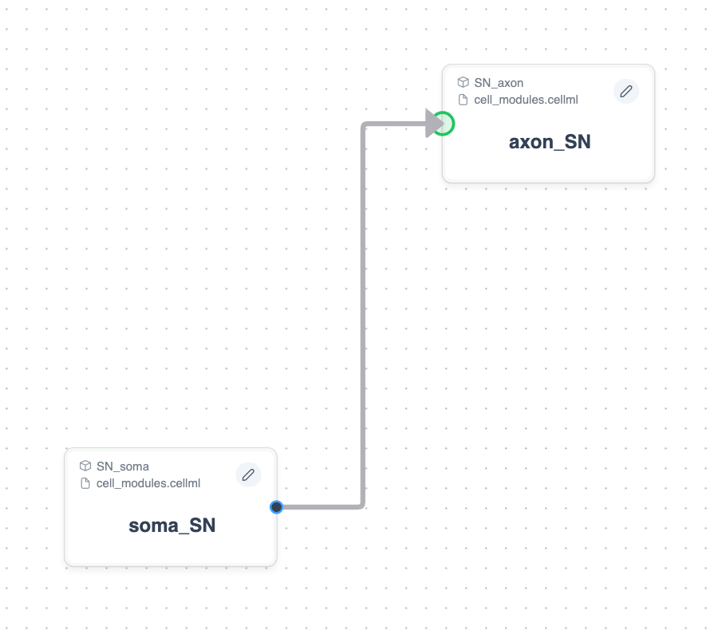
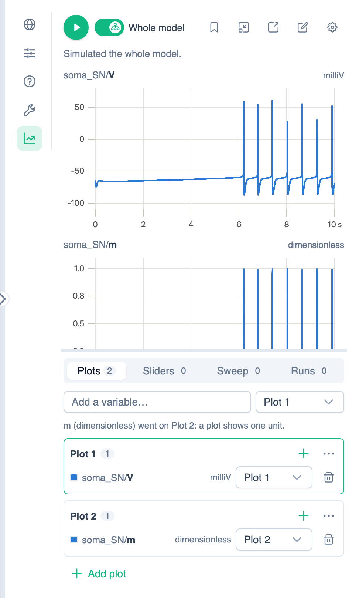

# Quick Start Guide

Build, simulate and export a small three-module nerve model.

## Layout

| Area | Where | Use |
| :--- | :--- | :--- |
| [Toolbar](../reference/ui-overview.md#toolbar) | Top | Load, save, import, export and edit tools |
| [Available Modules](../reference/ui-overview.md#module-library) | Left | Search and drag <GlossaryLink term="modules"/> |
| [Workspace](../reference/ui-overview.md#workspace) | Centre | Assemble the model |
| [Context Sidebar](../reference/ui-overview.md#context-sidebar) | Right (icon rail) | Parameters, properties and simulation |

{.align-center width="800px"}

## Step 1: Place and Rename {#step-1}

1. Download <a href="/examples/cell_modules.cellml" download>cell_modules.cellml</a>.
2. Import it with **Import ▸ CellML File**, or drop the file onto the canvas. A **CELL MODULES** group appears in Available Modules.
3. Expand the group (or search for `SN_`) and drag **SN_soma**, **SN_axon** and **SN_varicosity** onto the Workspace. Each placed copy is an *instance*.

   {.align-center width="800px"}

4. Click each instance's name and rename it: **SN_soma** to **soma_SN**, **SN_axon** to **axon_SN**, **SN_varicosity** to **var_SN**. (Double-clicking the node opens the Instance Editor instead.)

To use your own modules, see [Using Custom Modules](../guides/build-custom-module.md).

## Step 2: Connect {#step-2}

Hover over a node's edge until a green handle appears, then drag it to another node's edge. This creates the handles on both nodes and the connection. To remove a handle, hover over it and click the trash icon. A handle only marks where an arrow attaches; the ports you add in Step 3 decide which variables the connection shares.

{.align-center width="550px"}

Drag from **soma_SN** to **axon_SN**, then from **axon_SN** to **var_SN**. The node you drag from becomes the arrow's tail, the *source* in Step 3.

{.align-center width="800px"}

## Step 3: Configure Ports {#step-3}

<GlossaryLink term="ports"/> say which variables a connection shares. Set them up from each connection:

1. Double-click the **soma_SN → axon_SN** arrow to open the [Connections dialog](../reference/valid-port-configurations.md#connections-dialog). The source instance (soma_SN) is on the left, the target (axon_SN) on the right.
2. Add one port per table row below, on that instance's side. For soma_SN's VI_port: under **SOURCE: soma_SN** (left), click **Add Port**. Set **Type** to **O** (G = general, I = input, O = output), type `VI_port` in **Label**, open **Select variables** and tick **V**, then **I_out**. Leave **Mode** on Basicport (one connection per port).
3. Add axon_SN's ports under **TARGET: axon_SN** (right) the same way.
4. Ports with the same label and compatible types join automatically with a line, and turn green (**Connected**). If two ports don't join, drag from one port's handle to the other. Click **Done**.
5. Repeat for the **axon_SN → var_SN** arrow. axon_SN's ports are already there, now on the left; add var_SN's on the right.

{.align-center width="800px"}

**soma_SN**

| Type | Label | Variables |
| :--- | :--- | :--- |
| I | i_stim | I_in |
| O | VI_port | V, I_out |

**axon_SN**

| Type | Label | Variables |
| :--- | :--- | :--- |
| I | VI_port | V_in, I |
| O | membrane_voltage | V |

**var_SN**

| Type | Label | Variables |
| :--- | :--- | :--- |
| I | membrane_voltage | V |
| O | synaptic_NE | NE |

Coupled ports join their variables in order: first with first, second with second. Names don't have to match but the order does, so soma_SN's V joins axon_SN's V_in, and I_out joins I. Tick variables in the order shown; the chips in **Variables** show the order.

If you drag onto a port that is already connected, PhLynx asks whether to **Replace** that connection (or **Swap** the two, when it can).

You can also edit an instance's ports on the **Ports** tab of the [Instance Editor](../reference/ui-overview.md#instance-editor). See [Port Logic](../reference/valid-port-configurations.md#port-types) for the type rules.

## Simulate {#simulate}

1. Click **Simulation** (chart-line icon) on the right-hand rail. The scope switch should read **Whole model**.
2. Click **Simulate the whole model** (play icon), or press F9 while the panel has focus.
3. Check the line under the toolbar. It shows **Loading the simulator…** or **Running…**, then a summary such as *Simulated the whole model.* If it reads **Can’t simulate yet: N problems**, or mentions warnings, click it to list them (e.g. a parameter that needs a value; see [Set parameter values and types](../guides/build-custom-module.md#set-parameters)), fix them, and press Play again.
4. Click **Add a variable here** (plus icon) beside **Plot 1**. This puts the cursor in the **Add a variable…** search box above. Type `soma V` and pick **soma_SN/V**. The line appears at once from the run you just did.

The soma starts firing at about 6 s, so keep the default run of 0–10 s.

{.align-center width="550px"}

Sliders, tracked runs, protocols and sweeps are covered in [Simulating Your Model](../guides/simulating-your-model.md).

## Save and Export {#save-and-export}

- **Save:** click **Save workspace** (floppy-disk icon) or press Ctrl/Cmd+S. This saves a JSON file with the whole workspace, including simulation settings. Reopen it with **Load workspace** (folder icon).
- **Export:** open the arrow menu of **Export** (to the right of Import) and choose **CellML** for a flattened CellML 2.0 model. Other formats are listed in the [Interface Overview](../reference/ui-overview.md#export).
- **Open in OpenCOR:** click **Send to OpenCOR** (paper-plane icon) to open the model in Web OpenCOR.

> [!WARNING]
> PhLynx doesn't save automatically, and reloading or closing the tab loses unsaved changes, so save often. **Load workspace** replaces everything on the canvas without asking, so save first if you want to keep it.

Which file to keep:

| File | Use |
| :--- | :--- |
| Workspace (`.json`) | Your working copy. Reopens exactly, including imported modules you haven't placed. |
| OpenCOR export (`.omex`) | A runnable model to share. Opens in OpenCOR, and back in PhLynx with **Import ▸ COMBINE Archive** (graph, plots and sliders included). |
| CellML (`.cellml`) | One flattened model for other CellML tools. |

See [Supported File Formats](../reference/file-types.md) for what each holds.

## Next steps {#next-steps}

- Your own modules: [Using Custom Modules](../guides/build-custom-module.md) and [Writing CellML](../guides/writing-cellml.md).
- Results: [Simulating Your Model](../guides/simulating-your-model.md) for sliders, tracked runs, sweeps and protocols.
- Port rules: [Port Logic](../reference/valid-port-configurations.md).
- Cells and transporters: [Physiological View](../guides/physiological-view.md).
- Circulatory Autogen models: [Using PhLynx with Circulatory Autogen](../guides/use-with-circulatory-autogen.md).
