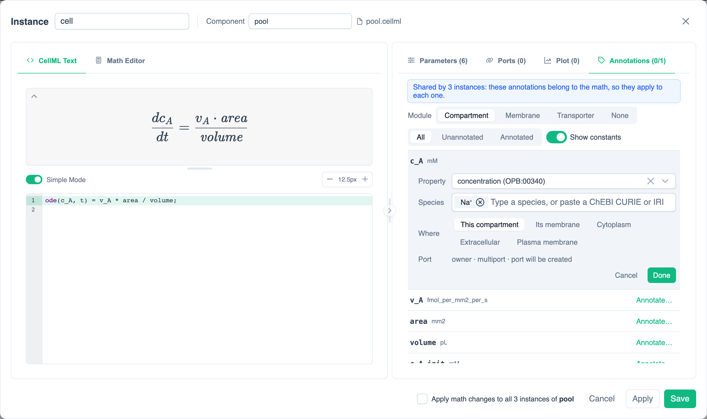
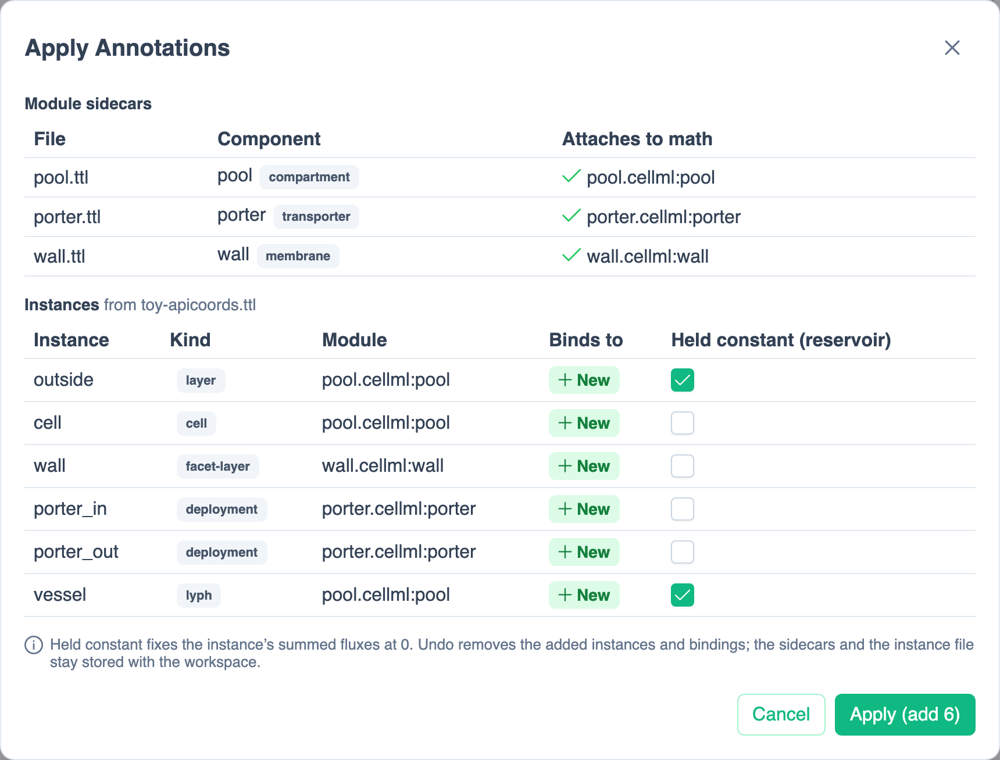
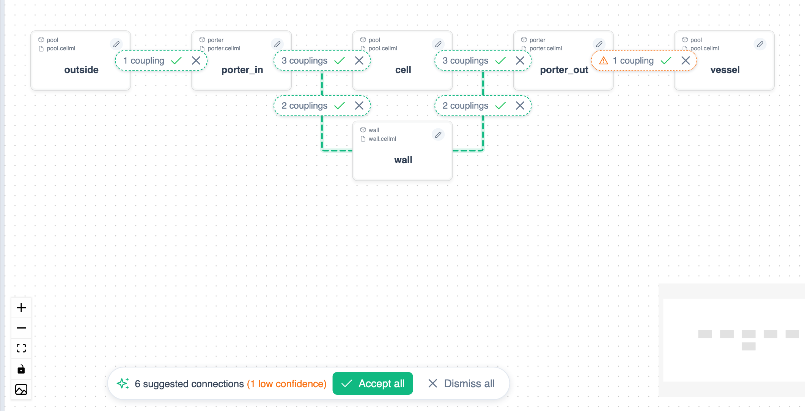
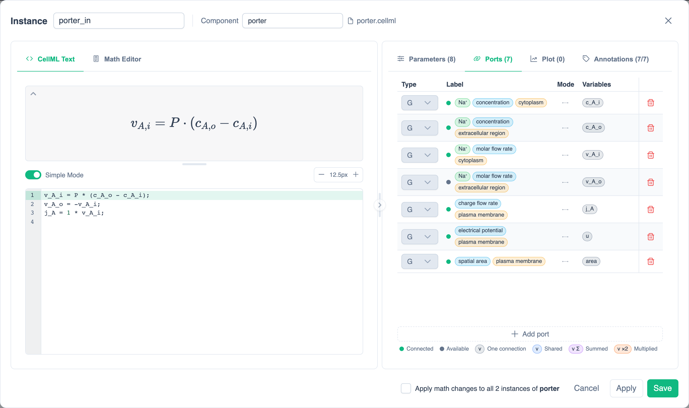

# Coupling with Annotations

Usually ports couple when their [labels](../reference/glossary.md#port-label) match. Annotations replace the label with what a variable means: its **property** (for example a concentration), its **species** (Na⁺) and its **location** (the cytoplasm). PhLynx then suggests the connections between annotated instances, and you accept them.

Annotations come from two kinds of file:

| File | Says | Written by |
| :--- | :--- | :--- |
| **Module sidecar** (`.ttl`), one per module math | What each variable of the module means, relative to wherever an instance of it sits | The module's author |
| **Instance ApiCoords** (`.ttl` or `.rdf`), one per model | Where each instance sits: which layer, cell, membrane, membrane protein or vessel | An ApiNATOMY curator, or you |

PhLynx combines the two. A transporter's sidecar says `c_A_i` is "Na⁺ concentration in the cytoplasm"; its ApiCoord says it is deployed on the apical facet of a particular cell; so `c_A_i` couples to that cell's concentration. The exact terms are in the [Annotation Vocabulary](../reference/annotation-vocabulary.md).

This guide uses a small synthetic model, whose files are in `tests/resources/annotations/toy/` in the PhLynx repository:

- `pool.cellml`, a compartment module, used three times: `outside` (a lumen), `cell` (the cell's cytoplasm) and `vessel` (blood in a vessel);
- `porter.cellml`, a transporter, used twice: `porter_in` on the cell's apical facet and `porter_out` on its basolateral facet;
- `wall.cellml`, the cell's plasma membrane, with its potential `u` and summed charge flow `i_tot`;
- `pool.ttl`, `porter.ttl` and `wall.ttl`, their sidecars;
- `toy-apicoords.ttl`, the instance ApiCoords.

## Annotate a Module with a Sidecar {#write-a-sidecar}

You can write a sidecar by hand, as below, or fill it in from the Instance Editor's [Annotations tab](#annotations-tab), which writes the same file.

A sidecar is a Turtle file beside the module's CellML. It annotates one component, and each variable you want coupled. Subjects are `<./{file}#{component}>` for the component and `<./{file}#{component}.{variable}>` for a variable, or `<./{file}#{id}>` for a variable with a CellML `id`.

```turtle
@prefix bqbiol: <http://biomodels.net/biology-qualifiers/> .
@prefix opb: <http://identifiers.org/opb/OPB_> .
@prefix chebi: <http://purl.obolibrary.org/obo/CHEBI_> .
@prefix sbo: <http://purl.obolibrary.org/obo/SBO_> .
@prefix m: <./pool.cellml#> .

# The component is a physical compartment.
m:pool bqbiol:is sbo:0000290 .

# c_A is the Na+ concentration of wherever the instance is.
m:pool.c_A bqbiol:isVersionOf opb:00340 ;
    bqbiol:isPropertyOf [ bqbiol:is chebi:29101 ; bqbiol:isPartOf m:pool ] .
```

1. **Say what the component is**, with `bqbiol:is`: a UniProt protein for a transporter, `GO:0005886` (plasma membrane) for a membrane module, `SBO:0000290` (physical compartment) for a compartment. PhLynx uses this to choose the module for each ApiCoord.
2. **For each variable**, give its property with `bqbiol:isVersionOf` an OPB term, and what it is a property of with `bqbiol:isPropertyOf`.
3. **Place it.** Either on the module itself (the component, or an entity `bqbiol:isPartOf` it), which means "here, wherever this instance is"; or relative to the instance, with a GO cellular-component term: `GO:0005737` cytoplasm, `GO:0005576` extracellular region, `GO:0005886` plasma membrane.

A flux always means the rate **into** the located entity: the porter's `v_A_i` is into the cytoplasm and `v_A_o` into the extracellular region. Contributions are always added ×1, so a factor such as a charge number belongs in the math, as its own variable (the porter's `j_A = 1·v_A_i`), which you then annotate.

PhLynx derives each variable's role from this, and never reads it from the file: a self-located quantity is an **owner** (or, for a flux, the **sum** of the fluxes into it); a relatively located one is a **reader** (or a **contributor** to a sum). See [Roles](../reference/annotation-vocabulary.md#roles).

## Annotate in the Instance Editor {#annotations-tab}

The Instance Editor's **Annotations** tab (tag icon) edits the module's sidecar for you. Its count, such as **Annotations (1/4)**, is how many listed variables are annotated.

{.align-center width="800px"}

- **Annotations belong to the math, not the instance.** Every instance of the math shares them; the banner says how many (**Shared by 3 instances**). Each instance's location still comes from its own ApiCoord.
- **Module** sets the component's kind: **Compartment**, **Membrane**, **Transporter** (with its UniProt accession) or **None**.
- Each row is a variable: annotated (chips, with **Edit** and **Clear**) or not annotated (**Annotate…**). **All**, **Unannotated** and **Annotated** filter the rows, and **Show constants** adds the constants. The variable of integration is never listed.
- **Annotate…** or **Edit** opens a form:
  - **Property**: one of the six coupling properties: concentration (`OPB:00340`), amount flow (`OPB:00592`), fluid volume (`OPB:00154`), area (`OPB:00295`), electrical potential (`OPB:00506`) or charge flow (`OPB:00318`).
  - **Species**: type a name. Common species and those other sidecars in the workspace use come first, then ChEBI results [looked up online](#ontology-lookup). You can also paste a ChEBI CURIE or IRI.
  - **Where**: **This compartment**, **Its membrane**, **Cytoplasm**, **Extracellular** or **Plasma membrane**.
  - **Port** shows the role, multiport mode and whether the port will be created, exists or is connected.
- Triples the tab can't show are listed under **Other annotations** and kept as written.

Edits are a draft until you click **Apply** or **Save**; **Cancel** asks before discarding them. A transporter can't be saved without a UniProt accession. Editing a template module's math asks for a new component name first, as other math edits do. One undo reverts the sidecar and every instance's ports together.

### Ontology Lookup {#ontology-lookup}

Species are looked up in ChEBI, and transporter accessions in reviewed UniProt entries, as you type. PhLynx uses EBI's [OLS](https://www.ebi.ac.uk/ols4/) and [UniProt](https://www.uniprot.org/), which need no account. Only the terms you choose are saved, as CURIEs. Labels found are remembered in the browser for 30 days, so chips show names such as "sodium(1+)" instead of CURIEs. Obsolete terms are marked.

Offline, the six properties, the five places, the common species, remembered labels and pasted CURIEs or accessions still work.

### Ports from Annotations {#auto-ports}

Every variable annotated with a property and a place has an annotated port, on every instance of the math. Ports are added, updated or removed when you apply or save, and when annotations are imported, pasted or a module is placed. If an edit would drop couplings, PhLynx asks first (**Removes N couplings on M connections**). A port you made by label is left as it is, beside the annotated one.

## Apply the Annotations {#apply}

1. Load the module maths into the library: **Import ▸ CellML File**, choosing `pool.cellml`, `porter.cellml`, `wall.cellml` and their units file `toy-units.cellml`.
2. Click **Import ▸ Annotations**. Under **Module Annotations (.ttl)** choose the three sidecars; under **Instance ApiCoords (.ttl or .rdf)** choose `toy-apicoords.ttl`. Click **Import**.
3. The **Apply Annotations** dialog opens.

{.align-center width="700px"}

- **Module sidecars** shows which math each sidecar attaches to. A sidecar attaches to the math its subjects name (`pool.cellml:pool`). If that math is not loaded, maths with the same component name are offered, and picked for you when there is only one; a sidecar whose component is in no loaded math is not stored.
- **Instances** lists each ApiCoord. Its **Instance** name is the subject's fragment (`model:porter_in` names `porter_in`), so after export the ApiCoord file points at the right CellML component. **Module** is chosen from the sidecars: a deployment runs the module whose component `bqbiol:is` its `api:protein`, a layer, cell or lyph runs a compartment, a facet-layer runs the module that `bqbiol:is` its `api:material`. If several fit, pick one; with none, the instance is skipped.
- **Binds to** is **New**, or an existing instance of the same subject, or else of the same name. Applying a second time binds instead of adding again.
- **Held constant (reservoir)**: see [Reservoirs](#reservoirs).

4. Tick **Held constant** for `outside` and `vessel`, then click **Apply (add 6)**. The six instances are placed in columns from lumen to vessel. Variables that ports will supply (readers and sums) become boundary conditions, so their values are only fallbacks. Undo removes them; the sidecars and the ApiCoord file stay stored with the workspace.

### Reservoirs {#reservoirs}

A reservoir is an instance large enough that the model's fluxes don't change it, such as a lumen or blood. Ticking **Held constant** sets the instance's summed fluxes (its aggregators, such as the pool's `v_A`) to constant 0 and drops their role, so no transporter is suggested to add into them. Its concentrations still couple. Applying onto existing instances ticks the box where their summed fluxes are 0 already.

With nothing held, the outer fluxes (`porter_in.v_A_o`, `porter_out.v_A_o`) are summed into the outside and the vessel too.

## Suggested Connections {#suggestions}

Once instances are bound to ApiCoords, PhLynx suggests every connection their annotations support, as dashed lines with a badge. The suggestions are recomputed whenever instances, bindings or connections change, and they are never saved or exported until accepted.

{.align-center width="800px"}

- Hover a badge to see its couplings, with where each end is and why.
- **Accept** (tick) makes the connection, with a port for each coupled variable. **Dismiss** (cross) hides it; **Show N dismissed** brings dismissed ones back.
- The panel at the bottom shows how many are suggested, with **Accept all** and **Dismiss all**. Accepting is one undo step, and undo brings the suggestion back.
- If a reader could couple to more than one owner, its coupling is marked **ambiguous** and **Accept all** leaves it out; accept that connection on its own. Two owners of the same quantity at the same place are a conflict and are not suggested.

Dragging a connection between two annotated instances on the canvas fills in the same couplings.

### Low Confidence {#low-confidence}

ApiCoords say what an apical facet faces (the lumen, layer 0 of the cell's host), but not yet what a basolateral facet faces. When exactly one lyph instance declares `api:coalescedWith`, PhLynx assumes the basolateral side faces that lyph. Such suggestions are dotted, in the warning colour, with a ⚠ whose tooltip gives the reason. In the toy, `porter_out → vessel` is low confidence. Check it before accepting. With no such lyph, or several, the basolateral side is left unconnected. See [Coalescence fallback](../reference/annotation-vocabulary.md#coalescence-fallback).

## Annotated Ports {#annotated-ports}

In the Instance Editor's **Ports** tab, and in the Connections dialog, an annotated port shows its meaning as chips in place of the label: species (green), property (blue) and location (amber). Its type and multiport mode are set by the annotation and can't be changed. The text comes from a table of common terms and the labels [looked up online](#ontology-lookup); other terms show as their CURIE.

{.align-center width="800px"}

Hover or click the chips for the detail: each term's IRI, where the location resolves on the instance's ApiCoord (for example `coord_porter_in → coord_cell → scope_tube`), the sidecar subject, and, for a mirrored port, where it was copied from. A low-confidence location has a dashed outline.

Each annotated variable has its port from the start; see [Ports from Annotations](#auto-ports).

An instance added from the library rather than by Apply has no ApiCoord, so it gets no suggestions.

### Connecting by Hand and Mirrored Ports {#mirrored-ports}

In the [Connections dialog](../reference/valid-port-configurations.md#connections-dialog), two annotated ports that don't match can't be connected. Dragging an annotated port onto the other instance's ghost port makes a new port there with the **mirrored** annotation: the complementary role, the same property and species, and a location that resolves to the same place from that instance's ApiCoord (or the resolved place itself, if it has none). Its chips, type and mode are locked, but you choose which variable it carries. Unannotated ports keep editable labels.

## Saving and Exporting {#export}

- **Save workspace** keeps the sidecars, the ApiCoord file, each instance's binding and reservoir tick, and dismissed suggestions.
- **Export ▸ CellML** and **Export ▸ OpenCOR** give each instance's component `id="<instance name>"` and each annotated variable an id, so `<./model.cellml#porter_in>` resolves.
- **Export ▸ OpenCOR** (OMEX) adds to the archive:
  - the sidecars, under `annotations/<file>/<component>.ttl`;
  - the ApiCoord file, byte for byte as imported;
  - `annotations.ttl`, the combined annotations of the exported model, written with the current instance names and variable ids.

  If you renamed a bound instance, the export warns that the ApiCoord file still names the old component; `annotations.ttl` has the new one.
- **Import ▸ COMBINE Archive** of such an archive restores the sidecars, the ApiCoord file, the bindings and reservoirs, and the couplings.

> [!WARNING]
> **Export ▸ Circulatory Autogen** stops with a message when any connection has couplings made by annotations: CA pairs ports by label, which annotated ports don't have. Export CellML or OMEX instead.
