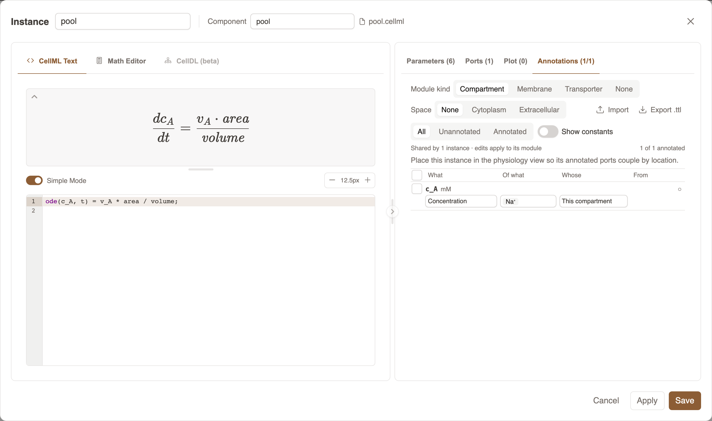
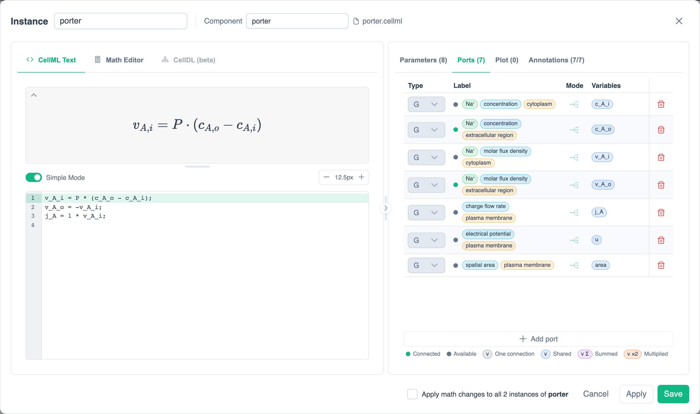

# Coupling with Annotations

Usually ports couple when their [labels](../reference/glossary.md#port-label) match. Annotations replace the label with what a variable means: its **property** (for example a concentration), its **species** (Na⁺) and **whose** it is (this compartment, or the cytoplasm next to it). Once instances are placed in the [physiology view](./physiology-view.md), PhLynx couples their annotated ports wherever the meanings match at the same place.

Annotations live in a **sidecar**: a Turtle file beside a module's math that says what each of its variables means, relative to wherever an instance of it sits. Where each instance sits comes from the physiology view: the template site it is dropped on, or the cell and facet it is drawn on. The exact terms are in the [Annotation Vocabulary](../reference/annotation-vocabulary.md).

This guide uses a small synthetic model, whose files are in `tests/resources/annotations/toy/` in the PhLynx repository:

- `pool.cellml`, a compartment module, used for the lumen and the interstitium;
- `porter.cellml`, a transporter, used on the cell's apical and basolateral membranes;
- `wall.cellml`, a plasma membrane, with its potential `u` and summed charge flow `i_tot`;
- `pool.ttl`, `porter.ttl` and `wall.ttl`, their sidecars;
- `toy-units.cellml`, their units.

## Annotate in the Instance Editor {#annotations-tab}

The Instance Editor's **Annotations** tab edits the module's sidecar for you. Its count, such as **Annotations (1/4)**, is how many listed variables are annotated.

{.align-center width="800px"}

- **Annotations belong to the math, not the instance.** Every instance of the math shares them; the status line says how many (**Shared by 3 instances**).
- **Module kind** says what the module is: **Compartment** (with the kind of **Space** it is), **Membrane**, **Transporter** (with its UniProt accession) or **None**. The physiology view draws the module from this.
- Each row is a variable, with its **Units**. **All**, **Unannotated** and **Annotated** filter the rows, and **Show constants** adds the constants. The variable of integration is never listed.
  - **What**: the property, such as concentration (`OPB:00340`), molar flow rate (`OPB:00592`) or electrical potential (`OPB:00506`). A property whose units disagree with the variable's units is flagged.
  - **Of what**: the species. Type a name: common species and those other sidecars in the workspace use come first, then ChEBI results [looked up online](#ontology-lookup). You can also paste a ChEBI CURIE or IRI.
  - **Whose**: where the quantity is, relative to the instance. The choices follow the module kind: **This compartment**, **Its membrane**, **This membrane**, **Cytoplasm**, **Extracellular** or **Plasma membrane**.
  - **From**: for a flow, where it comes from.
  - **Port** shows whether the variable has an annotated port, and its role.
- Tick rows to set **What**, **Of what** or **Whose** for all of them at once, or **Clear** them.
- **Import** reads a sidecar file into the tab, after asking (**Import annotations**); **Export .ttl** saves the module's sidecar.
- Triples the tab can't show are kept as written; saving warns if an edit would drop any.

To annotate several library modules at once, use **Import ▸ Module Annotations** and pick their `.ttl` sidecars. Each file goes to the module its component subject names; files naming no module in the library are listed and skipped, and replacing existing annotations asks first. One undo reverts the import.

Edits are a draft until you click **Apply** or **Save**; **Cancel** asks before discarding them. A transporter can't be saved without a UniProt accession. Annotating a template module's math asks for a new component name first, as other math edits do. One undo reverts the sidecar and every instance's ports together.

Terms are only ever chosen by you: PhLynx never guesses an annotation.

### Ontology Lookup {#ontology-lookup}

Species are looked up in ChEBI, and transporter accessions in reviewed UniProt entries, as you type. PhLynx uses EBI's [OLS](https://www.ebi.ac.uk/ols4/) and [UniProt](https://www.uniprot.org/), which need no account. Only the terms you choose are saved, as CURIEs. Labels found are remembered in the browser for 30 days, so chips show names such as "sodium(1+)" instead of CURIEs. Obsolete terms are marked.

A row whose terms don't fit their ontology's ids (such as `OPB:0006096`, which has a GO id's seven digits, where OPB's have five) or that OLS doesn't know is marked with a warning icon, and the module's own such terms are listed above the table. Importing a sidecar, from the tab or **Import ▸ Module Annotations**, lists them too. PhLynx only warns: the terms stay as written.

Offline, the properties, the places, the common species, remembered labels and pasted CURIEs or accessions still work.

## Annotated Ports {#annotated-ports}

Every variable annotated with a property and a place has an annotated port, on every instance of the math. Ports are added, updated or removed when you apply or save, and when a sidecar is imported, an instance is pasted or a module is placed. If an edit would drop couplings, PhLynx asks first (**Remove Couplings?**).

While an instance has annotated ports, its manual ports are hidden; couplings already made through them are kept.

In the Instance Editor's **Ports** tab, and in the [Connections dialog](../reference/valid-port-configurations.md#connections-dialog), an annotated port shows its meaning as chips in place of the label: species, property and place. Its type and multiport mode follow from the annotation and can't be changed. Annotated ports aren't part of the module's config, so adding or dropping one never asks whether to overwrite the config or create a new one.

{.align-center width="800px"}

Hover or click the chips for the detail: each term's IRI, the place the annotation resolves to (for example **Apical fluid (lumen)**), and the sidecar subject. An instance that isn't placed says so.

## Couple by Placement {#placement}

An instance's place comes from where it sits in the [physiology view](./physiology-view.md):

- **On a template site**, the site says it: a module dropped on the apical membrane of the epithelial cell template is in that membrane, with the cell's cytoplasm on one side and the apical fluid on the other.
- **Off templates**, its role and the cell it is drawn on say it: a transporter on a cell's basolateral facet faces whatever compartment lies against that facet.

Two annotated ports couple when their property and species are equal, their places are the same, and their roles complement each other: a concentration's owner with a reader, or a sum of flows with a flow into it. See [Roles](../reference/annotation-vocabulary.md#roles).

To try it with the toy model:

1. Load the maths: **Import ▸ CellML File**, choosing `pool.cellml`, `porter.cellml` and `toy-units.cellml`.
2. Switch the header to **Physiology**, right-click the canvas and choose **Add Template ▸ Epithelial cell**.
3. Drag `pool` onto the apical fluid and onto the basolateral fluid, and `porter` onto the apical and basolateral membranes. Each porter is joined to the fluid it faces, but nothing couples yet.
4. Open one pool's Instance Editor, **Import** `pool.ttl` on its Annotations tab and **Save**; do the same for a porter with `porter.ttl`.

Each porter's outer concentration now reads the pool it faces, and its outer flux is summed into that pool. The couplings follow the annotations and the placement: they update when either changes. An instance with no place keeps the couplings it has.

Dragging a connection between two annotated instances fills in the same couplings.

### Hold Summed Flows at 0 {#hold-at-zero}

A reservoir is an instance large enough that the model's flows don't change it, such as a lumen or blood. On the Annotations tab of such an instance, tick **Hold summed flows at 0**: its sums of flows (such as the pool's `v_A`) are held at constant 0, so connected instances no longer sum into them. Its concentrations still couple. The tick belongs to the instance, not the math, and is saved with the workspace.

## Saving and Exporting {#export}

- **Save workspace** keeps the sidecars, each instance's place and its **Hold summed flows at 0** tick.
- **Export ▸ CellML** and **Export ▸ OpenCOR** give each component `id="<component name>"` and each annotated variable an id, so the annotations can name them.
- **Export ▸ OpenCOR** (OMEX) adds to the archive:
  - the sidecars, under `annotations/<file>/<component>.ttl`;
  - `annotations.ttl`, the combined annotations of the exported model in OMEX Metadata 1.2 form, written with the current names and variable ids.
- **Import ▸ COMBINE Archive** of such an archive restores the sidecars, the annotated ports and the couplings.

> [!WARNING]
> **Export ▸ Circulatory Autogen** stops with a message when any connection has couplings made by annotations: CA pairs ports by label, which annotated ports don't have. Export CellML or OMEX instead.
