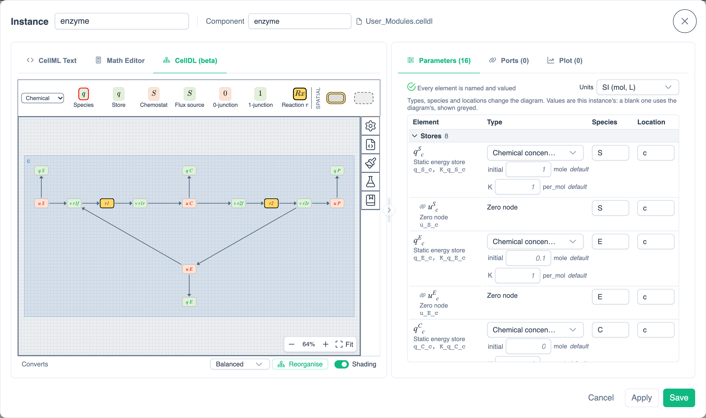
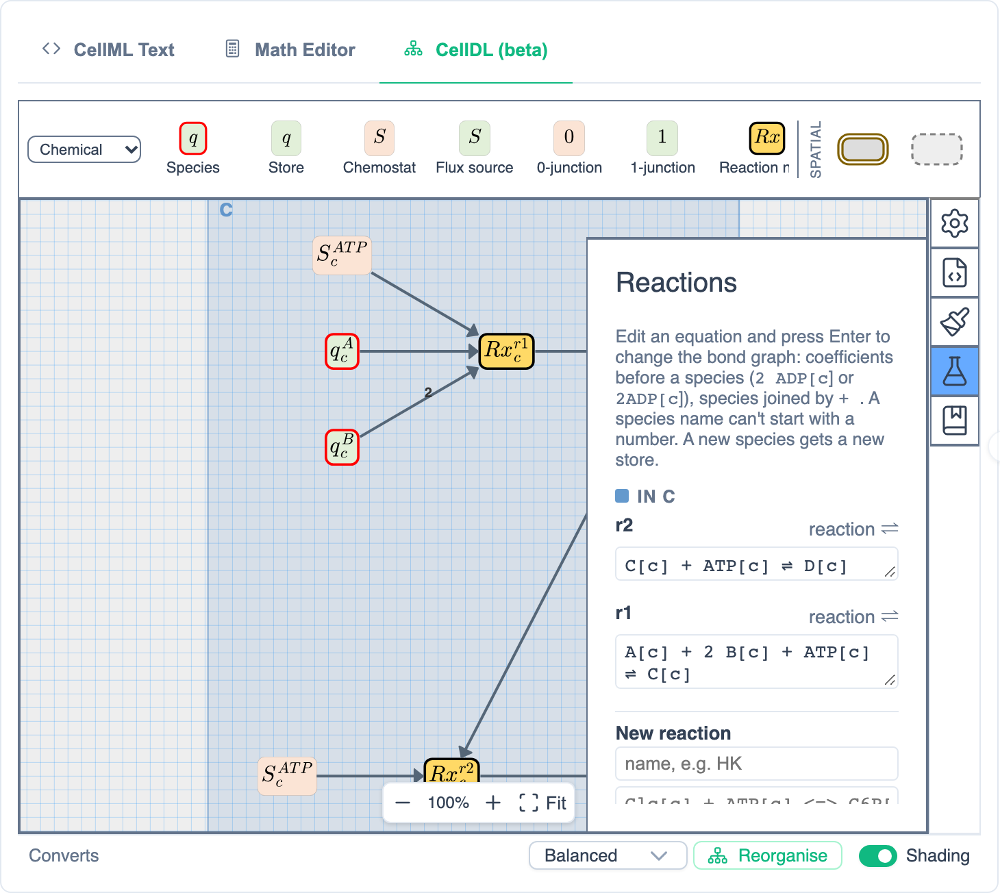
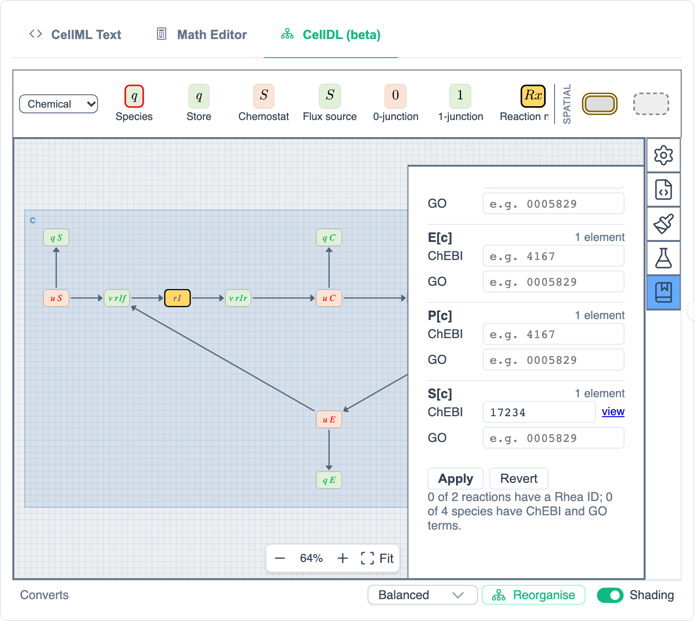
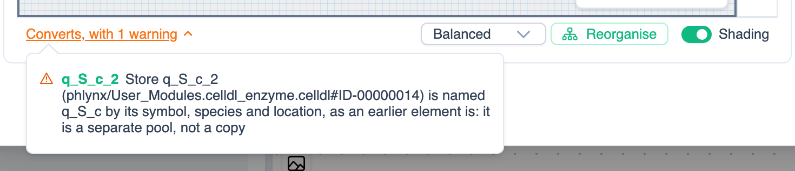
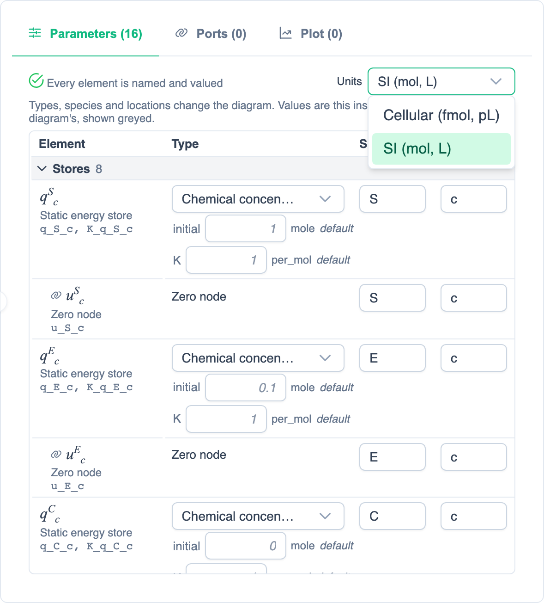

# Drawing CellDL Modules

> [!WARNING]
> **CellDL is in beta.** The editor and its file format may still change. Diagrams you save now should open in later versions of PhLynx, but that isn't guaranteed, so keep copies of work you need.

A **CellDL module** is a <GlossaryLink term="bond-graph">bond graph</GlossaryLink> drawn as a diagram in the Instance Editor's **CellDL (beta)** tab. PhLynx converts the diagram to CellML with bg2cellml as you draw. The generated CellML is shown read-only in the **CellML Text** tab (switch **Simple Mode** on or off to read it either way) and in the **Math Editor**. CellML Text groups its equations under headings: for a chemical model **Chemical potentials**, **Reaction affinities**, **Reaction flux**, **Species flux** and **Mass conservation** (the ODEs, last); other domains get general titles such as **Potentials** and **Conservation**. The headings are shown only in PhLynx: the CellML has no comments. Once saved, a CellDL module is placed, connected, simulated and exported like any other module.

{.align-center width="800px"}

CellDL isn't available in the desktop (Electron) build.

## Getting a CellDL Module {#getting-a-module}

- **Start from the template.** Drag **new_module** from **Template Modules** onto the canvas and open it. The first editor you change decides the module's format: draw in the **CellDL (beta)** tab and it becomes a CellDL module; type in **CellML Text** or the **Math Editor**, or edit the **Parameters** tab, and it becomes CellML, and the CellDL tab locks. Undo those edits to unlock it.
- **Import a diagram.** **Import ▸ CellDL Diagram** opens a `.celldl` file. It is converted first; if it converts, it is added to **Available Modules** under **User Modules (CellDL)**, named after the file. A diagram that doesn't convert, or that the editor can't draw, isn't added, and the message says why.
- **CellML modules** show the CellDL tab locked (*CellDL diagrams can only start from the template*). A CellML module can't be turned into a diagram.

## Drawing {#drawing}

The **palette** above the diagram holds the elements. Its dropdown picks the domain: **Chemical** (the default: Species, Store, Chemostat, Flux source, 0-junction, 1-junction, Reaction node, Reaction with sides), another physical domain, or **All domains**. Hover a tile for its description.

- **Place an element:** drag a tile onto the canvas, or click the tile and then click the canvas (each click places another; press Esc or click the tile again to stop). Right-click empty canvas and choose **Add element…** to search for one where you clicked.
- **Bond two elements:** hover an element, then drag from the handle that appears on its edge to the other element; or hold Ctrl (Cmd on Mac) and drag from the element itself. Valid targets are marked and the rest dimmed. A bond's direction matters: drawn the wrong way, it is refused with a message saying which way to drag, such as *Bonds point into a store. Drag from the junction to the store.*
- **Select:** click an element; hovering one lists its variables. Delete or Backspace removes the selection.
- **Align and distribute:** select two or more elements and use the buttons at the top right of the canvas (**Align left**, **Align centre**, **Align top**, …; distributing needs three or more). Aligning centres puts them exactly on one line, and bonds between the selected elements are straightened.
- **Straighten:** right-click a bent bond, or a selection with bent bonds between its elements, and choose **Straighten** to remove the bends (one undo step). It is offered only when there are bends.
- **Zoom and pan:** by default a mouse wheel zooms and a trackpad's two-finger scroll pans (Shift+wheel pans across). Pinching, or Ctrl/Cmd+wheel, always zooms. The **Scrolling in CellDL diagrams** [setting](#settings) (**Automatic**, **Pan** or **Zoom**) changes what plain scrolling does. The controls at the bottom right zoom out (-), in (+) and **Fit** (Shift+1). A diagram opens fitted to the view, at no more than 100%, or at the zoom you last left that module at if that was closer.
- **Undo and redo:** Ctrl/Cmd+Z and Ctrl/Cmd+Shift+Z or Ctrl/Cmd+Y while working in the diagram, including **Style** panel edits. Undo in another tab doesn't touch the diagram.

### Panels {#panels}

The icons on the right of the canvas open five panels:

| Panel | Icon | Use |
| :--- | :--- | :--- |
| **Properties** | Cog | The selected element's properties, such as its template (type) and location. Values are shown read-only: *Set values in the Parameters tab*. |
| **Metadata** | Document | The diagram's metadata. |
| **Style** | Brush | Colours, lines and text of the selection. |
| **Reactions** | Flask | Each reaction as an equation; see below. |
| **Annotations** | Book | Ontology terms for each reaction and species; see [Annotating](#annotations). |

### Writing Reactions as Equations {#reactions-panel}

{.align-center width="600px"}

The **Reactions** panel lists each reaction as an equation, such as `A[c] + 2 B[c] + ATP[c] ⇌ C[c]`. Species are written `Name[location]`, joined by `+`. Spaces around `+` and the arrow are optional. A number before a species is always its coefficient (`2B[c]` or `2 B[c]`), so a species name can't start with a number: such a name is refused with a message. The arrow can be `⇌`, `⇄`, `↔`, `→`, `<=>`, `<->`, `=>`, `->` or `=`.

- **Edit a reaction:** change its equation and press Enter. A new species gets a new store, placed beside the reaction; a removed species loses its bond; a coefficient sets the bond's count. Esc restores the equation.
- **Add a reaction:** type a name (optional; unnamed reactions are R1, R2, …) and an equation such as `S[c] + E[c] <=> C[c]` under **New reaction**, then press Enter.

New elements start with parameters of 1 and initial values of 0. Set their values in the [Parameters tab](#parameters).

### Annotating {#annotations}

{.align-center width="600px"}

The **Annotations** panel lists every reaction and species in the diagram. Give a reaction its **Rhea** ID (or, ticked **Lumped**, the Rhea IDs of its parts), an SBO **Type** and an optional **UniProt** mediator; give a species its **ChEBI** entity and **GO** compartment (**Fill** sets one GO term for every species in a location). **view** opens a term's entry. **Apply** keeps the terms, which are saved with the diagram.

### Element Styles {#element-styles}

An element whose template has its own constitutive law, rather than its domain's default, is drawn in that law's style, with a small law label (such as *sat*) before its symbol.

### Compartments and Regions {#compartments}

The palette's **Spatial** tiles draw a **Compartment** (a box with a membrane wall) or a **Region** (a dashed box) round elements: click or drop to place one, or drag on the canvas to draw it. They are decorative only. An element's location comes from its own **Location** field, not from the box it sits in. [Location shading](#status-line) draws over the boxes.

## Live Conversion {#live-conversion}

The status line below the diagram says whether it converts:

| Status | Means |
| :--- | :--- |
| **Converting…** | Checking the latest edit. |
| **Converts and runs** | It converts, and libCellML found the CellML runnable. |
| **Converts** / **Converts, not yet saved** | It converts; save to run it. |
| **Converts, with N warnings** | It converts, but something looks wrong. |
| **N issues, checked again on save** | It doesn't convert yet, so it can't be saved. |

When there are issues, click the status (or focus it and press Enter) to list them. Each names its element: click the name to select the element and centre it at the same zoom. Elements with issues are outlined in the diagram.

{.align-center width="600px"}

### Reorganise and Shading {#status-line}

The right end of the status line holds:

- **Reorganise**, with its mode dropdown (**Balanced** by default; hover a mode for what it favours), lays the diagram out again by location and then says what changed. It is one undo step, and Compartment and Region boxes move with their contents.
- **Shading** switches location shading: a shaded region for each location, drawn behind the elements and over Compartment and Region boxes. Only the display changes. The same switch is in [Settings](#settings).

## The Parameters Tab {#parameters}

{.align-center width="500px"}

For a CellDL module, the **Parameters** tab lists the diagram's elements, grouped as **Stores**, **Reactions**, **Junctions**, **Other elements** and **Constants**.

- **Type, Species, Location** change the diagram (one undo step each). A store's 0-junction always follows its species and location. These fields need the diagram shown; **Show diagram** switches to it.
- **Values** are this instance's own. A blank value uses the diagram's, shown greyed with **default** beside it. Other instances of the module keep their own values. Values typed for a variable that an edit renames move to the new name.
- **computed** marks a variable the math works out (such as an inductor's acceleration), which takes no value.
- **Set by** *instance.variable* marks a value a [connection](#connecting) supplies; the field is read-only.
- The chips above the table (**N rows to set**, **N names clashing**) filter the table to rows with problems; hover a row's icon for details.

### Unit Systems {#unit-systems}

The **Units** dropdown sets the module's <GlossaryLink term="unit-system">unit system</GlossaryLink>, which its CellML is built in:

| Unit system | Amounts, volumes | Used for |
| :--- | :--- | :--- |
| **Cellular (fmol, pL)** | fmol, pL | New modules, by default (see [Settings](../reference/ui-overview.md#settings)), so cell-sized values are near 1. |
| **SI (mol, L)** | mol, L | Imported diagrams saved without a unit system. |

Changing it changes the units of the module's variables. On save, PhLynx lists the values it will rescale to keep the same quantities (for example, *fmol → mole, ×10⁻¹⁵*) and asks before **Rescale and Save**.

## Saving {#saving}

**Apply** saves and keeps the editor open; **Save** (Ctrl/Cmd+Enter) saves and closes. A diagram that doesn't convert isn't saved (**Diagram Has Errors**); one with warnings asks first (**Diagram Warnings**), with each warning linking to its element.

- **The template** always saves as a new component: **Save As New Component** asks for its name. Diagrams from the template, and imported ones, go in the **User_Modules.celldl** grouping (**User Modules (CellDL)** in Available Modules).
- **An existing CellDL module** saved under its own name asks **Overwrite Math?**: **Overwrite** updates the module (every instance of it gets the new diagram and math, each keeping its own values), **Save as new component** saves your changes under a new name for this instance only, and **Cancel** goes back to editing.
- **Renaming** the **Component** field saves the diagram as a new module for this instance, leaving the others on the old one. Renaming onto another CellDL module's name asks before overwriting it.
- **Apply math changes to all N instances**, shown when other instances use the module, also switches them to the new math when you save as a new component. Their values and ports stay their own.
- **Layout-only edits**, such as moving elements or restyling them, save without asking: the math doesn't change.
- CellDL and CellML modules never overwrite each other, and templates can't be overwritten.

Saved diagram edits can be undone from the workspace (Ctrl/Cmd+Z), like other module edits.

## Plotting from the Diagram {#plotting}

Open the **Plot** tab and keep **Auto-update** on: clicking a junction or element in the diagram then plots its main variable (for example, a 0-junction's potential). With another tab shown, clicking only selects. See [Plotting from the Math](./simulating-your-model.md#plotting-from-the-math).

## Connecting CellDL Modules {#connecting}

CellDL modules connect like CellML modules: add ports on the **Ports** tab, then draw arrows between instances ([Connections](../reference/ui-overview.md#connections)).

- **An initial value can come from a connection.** Put a store's initial value (e.g. `q_S_c_init`) on a port and connect it to a variable another instance supplies. The Parameters tab then shows it as **Set by** that variable.
- **A store's amount can be driven by a connection.** If a connection would set a store's amount (e.g. `q_S_c`) from a variable another instance computes, PhLynx asks **Set a store from a connection**. **Set from connection** makes the connection; that instance then drops its own equation (dq/dt) and initial value for the store. **Cancel** leaves the connection unmade. Deleting the connection restores the store's own dynamics.
- The Circulatory Autogen export doesn't support driven stores yet, and stops with a message naming them.

## Settings {#settings}

In **Settings** (cog icon), under **CellDL diagrams**:

- **Bond arrowheads:** **Classic** (a closed arrowhead, the default) or **Bond graph** (a half arrow). Only the display changes.
- **Scrolling in CellDL diagrams:** **Automatic** (the default: a mouse wheel zooms, a trackpad pans), **Pan** or **Zoom**. Pinching, or Ctrl/Cmd+wheel, always zooms.
- **Location shading:** on by default; the same as the status line's **Shading** switch.
- **New CellDL modules: unit system:** **Cellular (fmol, pL)** (the default) or **SI (mol, L)**. Each module keeps its own after that.

## Saving and Exporting {#exporting}

- The [workspace file](../reference/file-types.md#workspace-file) keeps every CellDL module's diagram, including modules in the library that have no instance on the canvas, so each opens in the CellDL tab again.
- OMEX archives ([COMBINE archive](../reference/file-types.md#combine-archive)) keep the diagrams of the modules placed on the canvas.
- **Export ▸ CellML** and **Circulatory Autogen** write the generated CellML; the diagram isn't included.

## Known Limitations (Beta) {#limitations}

- Transform nodes (transformers and gyrators) don't convert yet.
- Some BG-RDF templates need their composite "Node" versions: OldOsmosis and NKE, chosen on the plain Reaction tile, don't convert.
- Changing a module's unit system rescales its parameter values, but not protocol values, sweep ranges or saved results that use them. Update those by hand.
