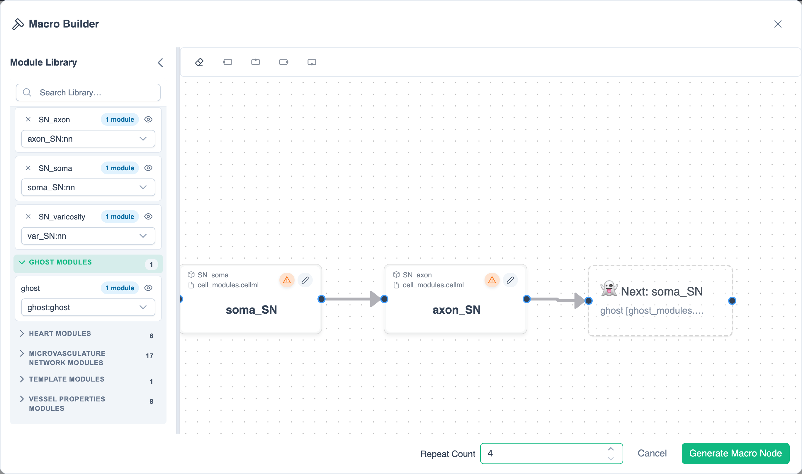

# Macro Builder Guide

The **Macro Builder** builds one segment of a model, then places a chain of copies of it (for example, a segmented vessel) in your workspace.

{.align-center width="800px"}

The dialog has the **Module Library** on the left, the canvas in the centre and **Repeat Count** at the bottom. The canvas toolbar has **Clear Macro Builder** (eraser icon) and **Add left/top/right/bottom handle**, which work on the selected instance.

## Build a macro

1. Click **Open macro builder** (hammer icon) in the [toolbar](../reference/ui-overview.md#toolbar).
2. Drag modules from the Module Library onto the canvas and connect them to make one segment.
3. *(Optional)* To link each copy to the next one, add a [ghost node](../reference/ghost-nodes.md) for the instance the next copy should connect into, then connect the segment's outlet to it.
4. Set **Repeat Count**. The default is 1.
5. Click **Generate Macro Node**.

The dialog closes. The copies are placed side by side at the centre of your view and left selected. Each instance gets a unique name. Without a ghost node, the copies are not connected to each other. **Cancel** closes the dialog without generating anything.
