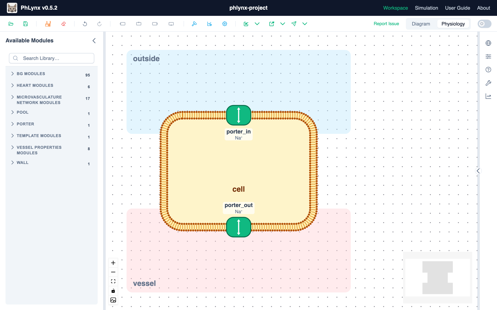
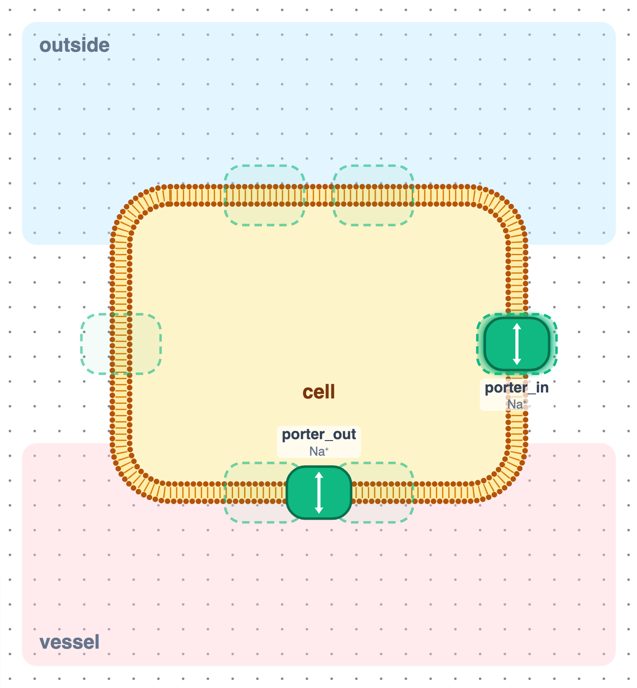
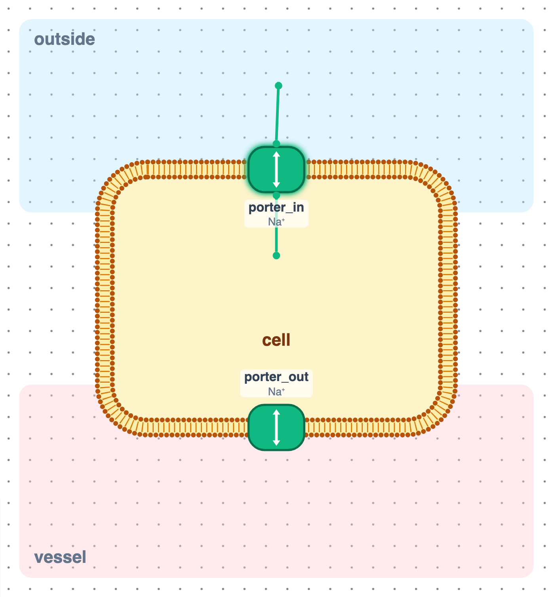

# Physiological View

The physiological view draws the same workspace as cells, membranes, transporters and the compartments around them, so you can check an epithelial or cellular model against the physiology it describes. It is another way of looking at the instances you already have: the diagram isn't changed, and edits made in either view apply to the same model. Choices you make here are saved with the workspace.

Switch views with **Diagram** / **Physiology** in the header, beside the light/dark switch ([Toolbar](../reference/ui-overview.md#toolbar)).

{.align-center width="800px"}

## Where the picture comes from {#roles}

Each instance gets a role: a cell (its inside), a cell's membrane, a protein in a membrane, a process inside a cell, or a region outside cells. PhLynx reads roles from annotations:

- **ApiCoord placement**, the instance file you load with **Import ▸ Annotations**, says which cell each instance belongs to and which side of it a protein sits on.
- **Module sidecars** (`.ttl` files imported alongside it) say what each module is, e.g. a membrane protein with a GO function, which picks its cartoon.

An instance with no annotations is drawn as a card to the right of the cells. To place it, right-click it and choose a role under **Show As**.

## Reading the view {#reading}

| What you see | Meaning |
| :--- | :--- |
| Rounded outline drawn as a lipid bilayer | A cell. Its inside is the cell's instance; the outline is its membrane instance. |
| Top / bottom / left and right sides | The **apical**, **basolateral** and **lateral** membranes. |
| Coloured block against the cell | A region outside cells, such as a lumen or a capillary, lying against the membrane it borders. |
| Cartoon in the membrane | A membrane protein. Its name and the species it carries (e.g. Na⁺ · glucose) sit under it, on the cell's side. |
| Card inside the cell | A process in the cell. |
| Card beside the cells | An instance with no physiological role. |

Each protein is turned so its outside faces out of the cell. Its cartoon comes from its annotated function, or from your choice under **Cartoon**:

| Cartoon | Drawn as |
| :--- | :--- |
| **Channel** | Two halves with a pore between them. |
| **Uniporter** | A block with a notch in its outer face. |
| **Pump** | A block with **ATP** bound on its cytoplasmic side. |
| **Symporter**, **Antiporter**, **Generic** | A plain rounded block. |

**Arrows** show the species the protein carries, one per species. They are two-way until you run a simulation; after a run each points the way its species was going at the end. After a [sweep](./simulating-your-model.md#sweeping-a-parameter) they stay two-way.

An **orange badge** (two-way arrows icon) on a protein means you've moved it away from where its annotations put it. Hover it to see which membrane that was.

## Editing the layout {#editing}

{.align-center width="600px"}

- **Move a protein:** drag it. While you drag, dashed slots show where it can go in each membrane; the one under it lights up. Drop it on a slot to put it there.
- **Take a protein out:** drop it away from any slot, or right-click it and choose **Take Out of Membrane**, which puts it to the left of the cells. A protein in no membrane is drawn faded.
- **Edit an instance:** double-click it to open the [Instance Editor](../reference/ui-overview.md#instance-editor).

Right-click an instance for:

| Item | Does |
| :--- | :--- |
| **Show As** | Sets its role: **Membrane protein**, **Membrane**, **Cell**, **Process in a cell**, **Region outside cells** or **Card**. |
| **Cartoon** | (Proteins) Picks the cartoon. |
| **Lies Against** | (Regions) Picks the side of a cell it borders: **Apical side**, **Basolateral side**, **Left side (paracellular)** or **Right side (paracellular)**. |
| **Take Out of Membrane** | (Proteins in a membrane) Moves it out. |
| **Reset to Annotations** | Drops your choices for this instance and goes back to what the annotations say. |

Right-click empty canvas for:

- **Add Cell…:** pick a module for the cell's inside and, optionally, one for its membrane.
- **Add Compartment…:** pick a module for a region outside cells.
- **Re-layout Physiology:** lays everything out again from the roles. Your **Lies Against** choices are kept.

### Adding modules {#adding-modules}

Drag a module from Available Modules onto a membrane slot to add it there as a protein. Drop it anywhere else and a **What is it?** dialog asks for its role and, where it needs one, its cell and side. **Apply** places it; it also appears in the diagram.

All of these are undoable (Ctrl/Cmd+Z).

## Seeing couplings {#couplings}

With nothing selected, the view shows just the physiology. Select a protein, cell or region to see its couplings, as short lines from the face each one is on: a protein's outer face couples to the region outside, its inner face to the cell.

{.align-center width="600px"}

Hover a line to see the variables it couples, as `instance.variable ↔ instance.variable`. A protein's coupling to its own membrane isn't drawn, since the protein already sits in it. To edit couplings, switch to **Diagram** and double-click the arrow ([Connections](../reference/ui-overview.md#connections)).

## Limits {#limits}

- Paste, duplicate (Ctrl/Cmd+D) and [workspace search](../reference/ui-overview.md#search) work in the diagram only.
- PhLynx reads ApiCoord placement but never writes it. Moving a protein or changing a role is saved in the workspace, not in the instance file.
- **Export image** (picture icon, bottom-left) saves the physiological view. It clears the selection first, so coupling lines are left out.
