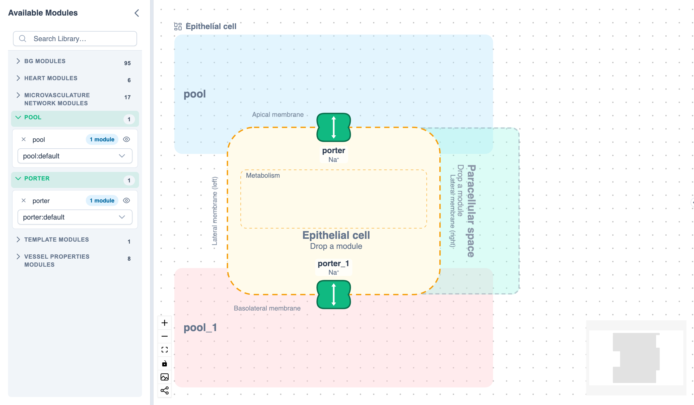

# The Physiology View

The physiology view draws the workspace as physiology: cells, their membranes, the proteins in them and the compartments around them. It shows the same instances and connections as the diagram, so an edit in one shows in the other. Switch between them with **Diagram** / **Physiology** at the top right of the workspace.

> [!NOTE]
> The physiology view is a beta feature, marked **Beta** on its switch: its behaviour may change between releases.

{.align-center width="800px"}

## What Each Instance Is {#roles}

Each instance is drawn by its role:

| Role | Drawn as |
| :--- | :--- |
| **Membrane protein** | A cartoon on one facet of a cell's membrane: apical, lateral or basolateral |
| **Membrane** | The cell's outline, selectable apart from its inside |
| **Cell** | The cell's inside (cytoplasm) |
| **Process in a cell** | A box inside a cell, such as glycolysis |
| **Region outside cells** | A compartment, such as a lumen or the interstitium |
| **Card** | Nothing physiological is known |

The role comes from the module's [Module kind](./annotation-coupling.md#annotations-tab) (**Transporter**, **Membrane** or **Compartment**), else from where its annotated variables are. To choose one yourself, right-click the instance and pick **Show As**; **Reset to Annotations** undoes your choice. Right-click a compartment for **Lies Against**, to say which facet of which cell it borders.

Double-click an instance to open its [Instance Editor](../reference/ui-overview.md#instance-editor). Right-click it for **Rename…**, which renames the instance as the diagram does (a name another instance has is refused), for **Connections**, which lists the instances it is coupled to and opens each coupling, or for **Apply Parameter Set**, which applies another of its math's [parameter sets](./use-with-circulatory-autogen.md#parameter-files) as the diagram's menu does. With **Settings ▸ Auto-plot selection** on, selecting an instance after a run plots what its annotations say matters: a protein's flows, a compartment's concentrations, a membrane's potential.

Dragging a structure moves all of it; dragging a part moves only that part:

- **Structures**: a template's title, a cell (by its inside or its outline) or a template compartment moves the whole template. A hand-added cell takes its membrane, proteins, cards and the compartments lying only against it along.
- **Parts**: a protein (it snaps between slots, and can leave its cell), a process card and a module outside any structure move alone.

**Delete** or **Backspace**, or **Delete** on an instance's menu, deletes the selected instances from the workspace with their connections, as in the diagram. With a protein selected, right-click one of its connections for **Delete Connection**.

Every edit in the view is one undo step, named in the undo notice.

## Templates {#templates}

A template is a ready-made layout of cells and compartments with **sites** to drop modules on. Right-click the canvas and choose **Add Template**:

| Template | Holds |
| :--- | :--- |
| **Epithelial cell** | A polarised cell between the apical fluid (lumen) and the basolateral fluid (interstitium), with the paracellular space beside it |
| **Two-cell epithelium** | Two neighbouring epithelial cells sharing the fluids, with the paracellular space between them |
| **Vessel wall** | An endothelial cell between the vessel lumen (plasma) and the interstitium, with an interendothelial cleft |
| **Chemical synapse** | A presynaptic terminal above a postsynaptic cell, with the synaptic cleft between them |

Drag a module from Available Modules, or an instance already in the view, onto a site: a compartment, a cell's inside, its membrane, or a slot on one of its facets. While you drag, the sites of the piece under the pointer are outlined, with the one the drop would take in green: the membrane as a striped band along the cell's outline, the cell's inside as a tint within it (drop on the cell's **Drop a module** hint), and a facet's slots on its proteins, with a **+** past the last for a new one. Dropping on a protein puts the module before it. The label by the pointer names the target, such as **Plasma membrane (membrane)** or **Epithelial cell (intracellular space)**. A site holds one module; dropping on a full one asks **Replace module?**, and the module it held stays in the diagram as a card. A module dropped on a site is connected to the modules on the sites next to it, and those connections are drawn dashed until they carry couplings. Moving it to another site, or out of the template, takes away the connections its old place made; a connection you drew or edited by hand stays, and a notice names it. Placing and moving modules never changes their module configs, so it asks nothing about them; a drop takes the parameter set chosen on the module's library card.

To make a new module in place, right-click an empty site, or a slot on a facet or process zone, and choose **New Module Here**: it is placed and connected as a dropped one would be, and its first save makes it a module of its own.

Right-click an instance on a site to **Unbind** it. Right-click a template's title or any piece of it for **Rename Template…**, **Re-layout Template**, **Save Template As File…** and **Delete Template**, which keeps its modules: proteins go to the tray.

Each placed template can differ from its template without changing it or other placements:

- Right-click a cell for **Add Protein Site** on a free edge, **Add Compartment…** against one of its facets, or **Add Process Zone**.
- Right-click a piece for **Remove from This Template**: a whole cell (with its facets and processes), its membrane, a facet (with what lies only against it), a process zone or a compartment. When modules are placed there, PhLynx lists them and asks first; they stay in the diagram, and proteins go to the tray.
- **Restore Removed Elements** brings the template's removed pieces back and keeps what you added.

To build without a template, right-click the canvas and choose **Add Cell…** or **Add Compartment…**, picking the module for each. A hand-added cell takes drops as a template's does: on its membrane, while it has none, on its inside, and on its facets' slots.

### My Templates {#my-templates}

**Add Template ▸ Load Template File…** adds a template file (`.template.json`) to **My Templates**, which this browser keeps. A file that is too large, isn't JSON or isn't a valid template is refused with the reasons. **Remove from My Templates** removes one. The templates a workspace uses are saved with it, so it opens anywhere.

## Cartoons {#glyphs}

Each membrane protein is drawn with a cartoon: symporter, antiporter, uniporter, pump, channel, receptor or generic. PhLynx picks one from the module's GO molecular function; right-click a protein and choose **Cartoon** to pick another.

Cartoons are data in a glyph library. **Glyph Libraries ▸ Load Glyph Library…** (canvas right-click) adds a library file (`.glyphs.json`), whose cartoons then appear under **Cartoon**. Loaded libraries can be saved again as files or removed. The cartoons a workspace uses are saved with it, and image export includes them.

## Species Mode {#species-mode}

Species mode shows, in each compartment, a token for each annotated species, and the paths those species take through the proteins between compartments. Turn it on with the **Show species** button in the view's controls, or **Species Mode ▸ Show Species** on the canvas right-click menu. **Settings ▸ Species mode** opens the view in species mode.

- Click a token to focus that species in that compartment: its paths are highlighted, other species are set back, and after a run its amount and the flows into it are plotted. Click the canvas to clear the focus.
- Drag a token along its row to reorder the tokens in its compartment; a token cannot leave its compartment. The order is saved with the workspace and each reorder is one undo step. Dependence links meet their protein in the order of their tokens; paths stay under the cartoon's arrows. Right-click the compartment and choose **Reset Species Order** to go back to the automatic order.
- A protein that only reads a compartment's amount of a species, with no flow of it coupled there, is linked to its token by a faint dashed line ending in an open circle, as SBGN draws modulation. Only coupled, annotated ports are drawn; nothing is guessed.
- **Species Mode ▸ Coupled Species** shows only species whose quantities are coupled; **Species with Fluxes** shows only those with at least one path through a protein, so a held reservoir a protein only reads is hidden; **All Annotated Species** shows every species the annotations name. A focused species stays shown in **Species with Fluxes** until the focus is cleared.

## Exporting an Image {#export-image}

**Export image of the physiological view** (picture icon in the view's controls) saves the view as PNG or SVG, as set in [Settings ▸ Image export](../reference/ui-overview.md#settings).
