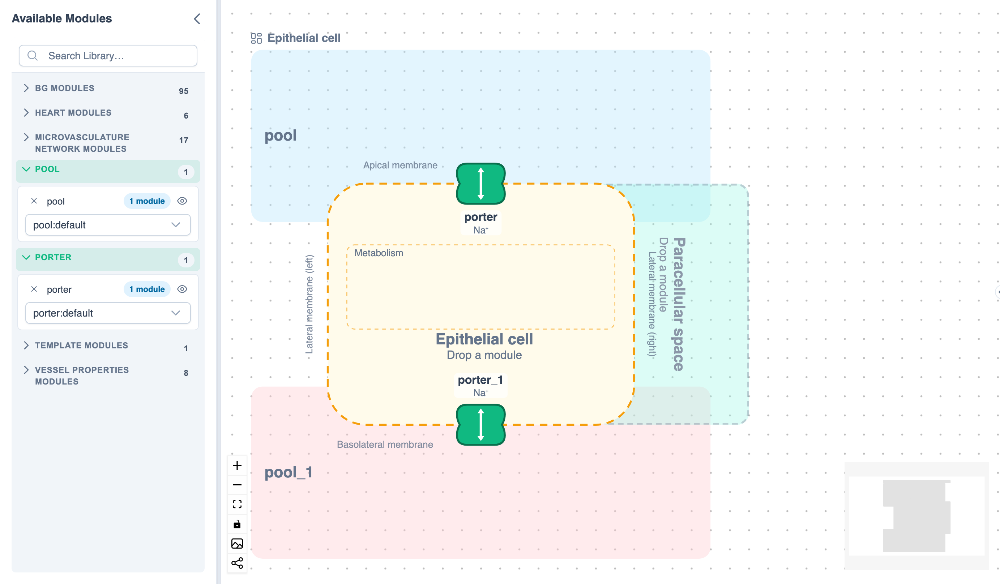

# The Physiology View

The physiology view draws the workspace as physiology: cells, their membranes, the proteins in them and the compartments around them. It shows the same instances and connections as the diagram, so an edit in one shows in the other. Switch between them with **Diagram** / **Physiology** at the top right of the workspace.

> [!NOTE]
> The physiology view is a beta feature, marked **Beta** on its switch: its behaviour may change between releases.

{.align-center width="800px"}

## What Each Instance Is {#roles}

An instance on a [piece](#building) is what its site is:

| Site | Drawn as |
| :--- | :--- |
| **A stretch of membrane** or a fold | A membrane protein: a [skin](#skins) on that stretch |
| **A membrane** | The cell's outline, selectable apart from its inside |
| **A cell's inside** | The cell's inside (cytoplasm) |
| **A process zone** | A process, such as glycolysis, drawn as its skin |
| **Any other compartment** | That compartment, such as a lumen or the interstitium |
| **A tube** | The flux through it, as a card in the tube or as its joint |

Moved to another site, it becomes what that site is.

An instance on no piece is drawn beside the pieces, as its module's annotations say: a protein in the tray on the left when its [Module kind](./annotation-coupling.md#annotations-tab) is **Transporter**, or its variables lie both inside and outside a cell; anything else as a card on the right, a process with its symbol. Drop it on a site to place it.

Double-click an instance to open its [Instance Editor](../reference/ui-overview.md#instance-editor). Right-click it for **Rename…**, which renames the instance as the diagram does (a name another instance has is refused), for **Connections**, which lists the instances it is coupled to and opens each coupling, or for **Apply Parameter Set**, which applies another of its math's [parameter sets](./use-with-circulatory-autogen.md#parameter-files) as the diagram's menu does. With **Settings ▸ Auto-plot selection** on, selecting an instance after a run plots what its annotations say matters: a protein's flows, a compartment's concentrations, a membrane's potential.

Dragging a structure moves all of it; dragging a part moves only that part:

- **Structures**: a cell (by its inside or its outline), an organelle, a compartment standing on its own and a process zone move with everything in them, docked to them or joined to them by a tube (see [Moving and Resizing](#moving-pieces)).
- **Parts**: a protein (it snaps between slots, and can leave its cell), a process and a module outside any structure move alone.

**Delete** or **Backspace**, or **Delete** on an instance's menu, deletes the selected instances from the workspace with their connections, as in the diagram. With a protein selected, right-click one of its connections for **Delete Connection**.

Every edit in the view is one undo step, named in the undo notice.

## Building the View {#building}

The view is built from five **pieces**, each with **sites** to drop modules on. The library's **Build** tab lists them, and the templates made from them. Drag a piece or template onto the view, or click it and then click where it goes. While a piece is carried, what it would go on is outlined in green and a dashed preview shows where it would be drawn; the label by the pointer says what it would do, or, in red, why it can't go there. Each piece or template placed comes with a new, empty module on each site that takes one, named for its site, for a library module to replace later.

| Piece | Dropped | Sites |
| :--- | :--- | :--- |
| **Compartment** | By a membrane's side, docked against it inside or outside; in a compartment; or on its own | Its inside |
| **Membrane** | By a compartment's edge, round it and what tubes join it to (a new cell); in a compartment (an organelle); or on its own (a new cell) | The membrane, and each stretch of it a protein site |
| **Tube** | On a compartment, joined to the nearest other one: a flow between free compartments; an open channel between two spaces of one cell; between two cells, a **Gap junction** (connexons where their membranes meet) or a **Bridge** (an open channel of cytoplasm across the gap, walled by membrane). Which of the two is asked each time, unless **Remember this choice** is ticked or **Settings ▸ Physiological view ▸ A tube between two cells** says | One module, for the flux |
| **Fold** | By a membrane's side: an invagination such as a T-tubule | Protein slots down its walls |
| **Process zone** | In a compartment | Process slots |

Each stretch of a membrane that a compartment is docked to is a protein site of its own, so the proteins on it meet that compartment.

### Templates {#templates}

A template is a shortcut: placing one adds a copy of its pieces, which are then edited like any others. Pick one from the Build tab, or right-click the canvas and choose **Add Template**. A template from the Build tab that is dropped on a compartment goes inside that compartment, which grows to fit it. Dropped anywhere else, it goes on the canvas:

| Template | Holds |
| :--- | :--- |
| **Cell** | A plain cell to build on |
| **Epithelial cell** | A polarised cell between the apical fluid (lumen) and the basolateral fluid (interstitium), with the paracellular space beside it |
| **Two-cell epithelium** | Two neighbouring epithelial cells sharing the fluids, with the paracellular space between them |
| **Chemical synapse** | A presynaptic terminal above a postsynaptic cell, with the synaptic cleft between them |
| **Cardiomyocyte** | A muscle cell with a T-tubule, the sarcoplasmic reticulum and the dyadic cleft between them |
| **Rod photoreceptor** | An outer and an inner segment, each with its own artwork, joined by the connecting cilium, an open channel |

### Placing Modules {#placing}

Drag a module from Available Modules, or an instance already in the view, onto a site: a compartment, a cell's inside, its membrane, a tube, or a slot on a stretch of membrane or in a process zone. While you drag, the sites of the piece under the pointer are outlined, with the one the drop would take in green: the membrane as a striped band along the cell's outline, the cell's inside as a tint within it (drop on the cell's **Drop a module** hint), and a stretch's slots on its proteins, with a **+** past the last for a new one. Dropping on a protein puts the module before it. An empty process zone takes a drop anywhere in it; once it holds a process, drop on its row, as the rest of it is the cell's. The label by the pointer names the target, such as **Plasma membrane (membrane)** or **Epithelial cell (intracellular space)**. A site holds one module; dropping on a full one asks **Replace module?**, and the module it held stays in the diagram as a card. A module dropped on a site is connected to the modules on the sites next to it, and those connections are drawn dashed until they carry couplings. Moving it to another site, or off the pieces, takes away the connections its old place made; a connection you drew or edited by hand stays, and a notice names it. Placing and moving modules never changes their module configs, so it asks nothing about them; a drop takes the parameter set chosen on the module's library card.

To make a new module in place, right-click an empty site, or a slot on a stretch of membrane or in a process zone, and choose **New Module Here**: it is placed and connected as a dropped one would be, and its first save makes it a module of its own.

Right-click an instance on a site to **Unbind** it: it is drawn beside the pieces, as its annotations say (see [What Each Instance Is](#roles)). Dropping a module from Available Modules anywhere off the pieces puts it there the same way.

### Moving and Resizing {#moving-pieces}

- Drag a cell, organelle, free compartment or process zone to move it. What is in it, docked to it or joined to it by a tube follows as you drag. A piece stays inside the one it stands in: dragged past its parent's right or bottom, the parent grows.
- Drag a compartment docked along part of one side to slide it along that side; the protein sites beside it make room.
- Hover over a cell, organelle, free compartment or process zone for the resize handle at its bottom-right corner.
- A compartment docked along one side has a grip on its far edge. Drag it across the side to set how far the compartment reaches. Drag it onto another membrane's side or a fold to dock the compartment there too, so that it lies between the two: the green outline and the label by the pointer show what it would dock to. A dyadic cleft between an organelle and a T-tubule is built this way: dock a compartment beside the organelle, then drag its far edge onto the T-tubule's wall. Between a fold and a side, or two sides that face each other, it is drawn as the gap between them.
- Drag a fold by the grip at its end, along its side and deeper or shallower; a tube by the grip above its module, to bend it; and a tube's end grip onto another compartment, to join it there.

### Editing Pieces {#editing-pieces}

Right-click a piece for:

- **Rename Piece…**. A click on an empty piece's name renames it too.
- **Skin** and, on a cell, **Membrane Skin**: how the piece is drawn. See [Skins](#skins).
- **Fit to Contents**: shrinks a cell or compartment back to what its contents need. A piece never shrinks on its own.
- **Straighten Tube**: takes a tube's bend away.
- **Detach From**: on a compartment docked to more than one membrane side or fold, takes it off one of them, leaving it against the rest.
- **Remove**: a piece, with what can't stand without it, such as the fluids docked to a membrane. On a cell, choose the whole cell or its membrane alone, which leaves its inside where it was; folds, process zones and tubes on it are listed too. When other pieces go along, or modules are placed on what goes, PhLynx says so and asks first; the modules stay in the diagram, drawn beside the pieces as their annotations say.

### My Templates {#my-templates}

**Load file…** at the end of the Build tab's templates, or **Add Template ▸ Load Template File…**, adds a template file (`.pieces.json`) to **My Templates**, which this browser keeps, and places it. A file that is too large, isn't JSON or isn't a valid template is refused with the reasons. **Add Template ▸ Save My Template As File…** saves one of yours as a file, and **Remove from My Templates** removes one. **Save Pieces As Template File…** on the canvas right-click menu saves every piece of the view as a template file. The pieces a workspace is built from, and its skins, are saved with it, so it opens anywhere.

## Skins {#skins}

Proteins, processes, compartments and membranes are each drawn with a skin. Each is offered only the skins that suit what it is:

| What | Skins |
| :--- | :--- |
| Membrane protein | Symporter, antiporter, uniporter, pump, channel, receptor, generic |
| Process | Myofilament, mitochondrion, process, or none (a plain card) |
| A cell's inside, an organelle's inside, a compartment within a cell, a space outside cells | None, or SVG artwork, such as the rod's segments |
| Cell membrane | Lipid bilayer, plain wall |
| Organelle membrane | Lipid bilayer, double membrane, plain wall |
| A tube's joint, where its two ends touch | Conduit: narrowing vessel. Gap junction: connexon pair. Bridge or diffusion: open way, dashed way |

PhLynx picks a skin from the annotations: a module's GO terms (`bqbiol:isVersionOf`), or a compartment's term. A skin is chosen only for what it suits: a protein is never drawn as a mitochondrion. In the menus, the skins that match the annotations come first.

To choose another:

- Right-click a protein or process and choose **Skin**.
- Right-click a cell and choose **Skin** for its inside, or **Membrane Skin** for its membrane. Right-click a compartment and choose **Skin**.
- Right-click a tube's joint, or the module drawn as it, and choose **Skin**. A conduit between compartments apart is drawn as a vessel along its whole way, whatever its skin.
- Or select things of one kind and pick a tile under **Skin** in the Properties panel.

For artwork, **Fill** and **Strength** set how it is drawn, and **Load SVG…** adds a drawing of your own to the **My skins** library and uses it. A process in a process zone always has a skin: with none chosen, it is drawn as the generic process.

**Skin Libraries ▸ Load Skin Library…** (canvas right-click) adds a [skin library file](../reference/file-types.md#skin-files) (`.skins.json`). Its skins then appear in the menus of what they suit. Loaded libraries, **My skins** among them, can be saved again as files or removed. The skins a workspace uses are saved with it, so it opens anywhere, and image export includes them.

## Species Mode {#species-mode}

Species mode shows, in each compartment, a token for each annotated species, and the paths those species take through the proteins between compartments. Turn it on with the **Show species** button in the view's controls, or **Species Mode ▸ Show Species** on the canvas right-click menu. The view opens with species mode as you last left it.

- Click a token to focus that species in that compartment: its paths are highlighted, other species are set back, and after a run its amount and the flows into it are plotted. Click the canvas to clear the focus.
- Drag a token along its row to reorder the tokens in its compartment; a token cannot leave its compartment. The order is saved with the workspace and each reorder is one undo step. Dependence links meet their protein in the order of their tokens; paths stay under the arrows on the protein's skin. Right-click the compartment and choose **Reset Species Order** to go back to the automatic order.
- A protein that only reads a compartment's amount of a species, with no flow of it coupled there, is linked to its token by a faint dashed line ending in an open circle, as SBGN draws modulation. Only coupled, annotated ports are drawn; nothing is guessed.
- **Species Mode ▸ Coupled Species** shows only species whose quantities are coupled; **Species with Fluxes** shows only those with at least one path through a protein, so a held reservoir a protein only reads is hidden; **All Annotated Species** shows every species the annotations name. A focused species stays shown in **Species with Fluxes** until the focus is cleared.

## Exporting an Image {#export-image}

**Export image of the physiological view** (picture icon in the view's controls) saves the view as PNG or SVG, as set in [Settings ▸ Image export](../reference/ui-overview.md#settings).
