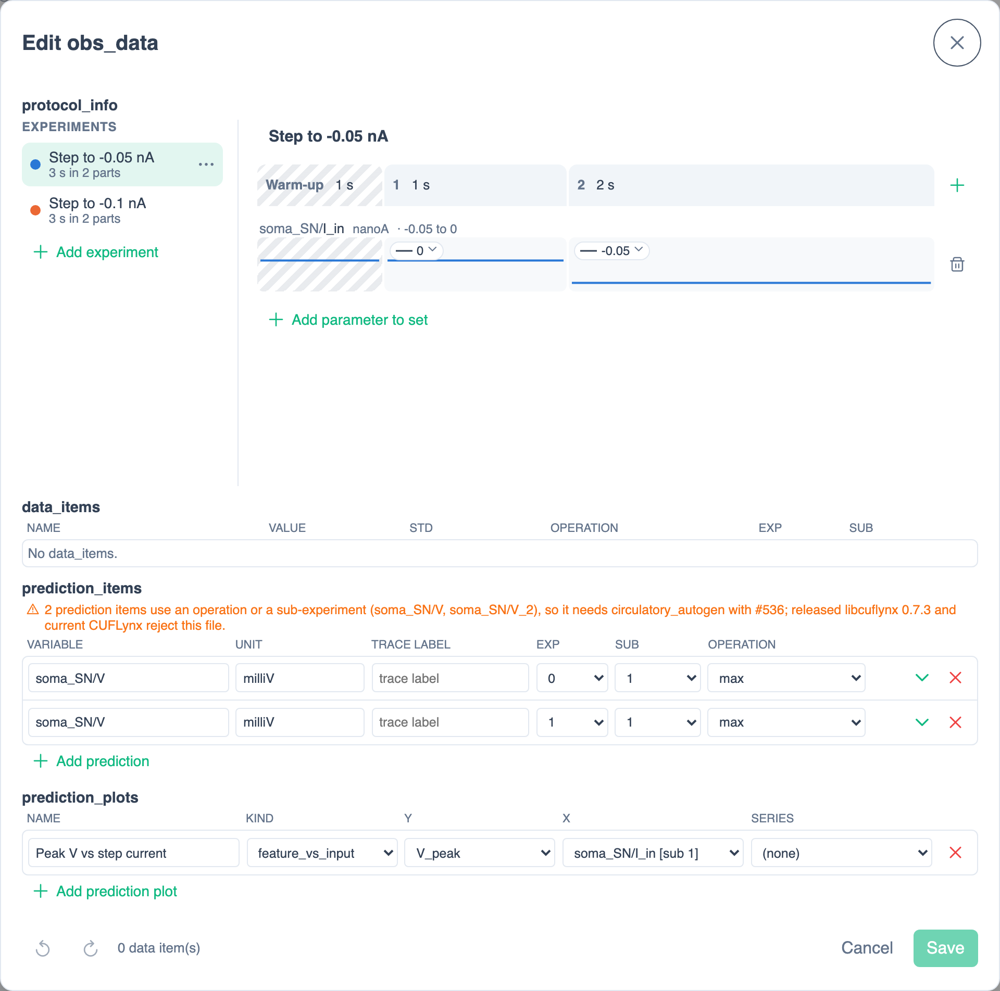
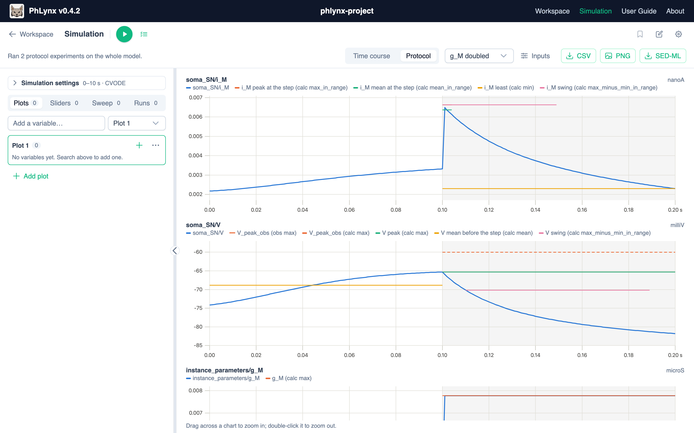

# Running Protocols

A **protocol** runs your model as a set of **experiments**. Each experiment can start with a **warm-up**, then runs one or more **sub-experiments** back to back, and sets chosen parameters to a value, step, pulse, pacing train, ramp or recorded trace in each one. It can also record **prediction items**: a variable's trace, or a feature of it such as its maximum.

A workspace has one protocol, stored as `obs_data.json`, the format CUFLynx and Circulatory Autogen use. The name means "observed data": Circulatory Autogen keeps the measurements a calibration fits (data items) in the same file as the experiments that produce them. You can import it in a COMBINE archive from CUFLynx, or create it in PhLynx.

| In the editor | In `obs_data.json` |
| :--- | :--- |
| Experiment name | `experiment_labels` |
| Warm-up | `pre_times` |
| Sub-experiment lengths | `sim_times` |
| Parameters and how they vary | `params_to_change` (shapes in `protocol_shapes`, traces in `protocol_traces`) |
| Prediction items, prediction plots | `prediction_items`, `prediction_plots` |
| Data items (read-only) | `data_items` |

## Creating or Editing a Protocol {#editing-a-protocol}

This walkthrough uses the three-instance SN model (`soma_SN`, `axon_SN`, `var_SN`). It builds two experiments. Each lets the soma rest for 1 s, then steps its input current `soma_SN/I_in` for 2 s, to -0.05 nA in the first experiment and -0.1 nA in the second. In this model, a negative `I_in` depolarises the soma, so it starts firing.

{.align-center width="800px"}

### Open the Editor {#open-the-editor}

1. Open the **Simulation** tab in the [Context Sidebar](../reference/ui-overview.md#context-sidebar) (chart-line icon).
2. In the Simulation toolbar, click **Edit obs_data** (pen-to-square icon), the second button from the right. The **Edit obs_data** dialog opens.
3. If the workspace has no protocol, click **Add protocol_info**. This creates **Experiment 1**, with no warm-up, one 1 s sub-experiment and no parameters.

The dialog has four sections: **protocol_info** (the experiments), **data_items**, **prediction_items** and **prediction_plots**. In **protocol_info**, the **Experiments** list is on the left and the selected experiment's timeline is on the right. The timeline has a **Warm-up** column, then a numbered column for each sub-experiment, sized by its length. Each parameter you set has a lane across the timeline.

### Set Up the First Experiment {#set-up-an-experiment}

To edit a number shown on the timeline, click it, type the new value and press Enter. Press Escape to keep the old value.

1. **Name it.** Click the name box above the timeline. It shows **Experiment 1** in grey until you name it. Type `Step to -0.05 nA` and press Enter. The name is used in the experiment picker and plot legends.
2. **Set the warm-up.** Click **0 s** beside **Warm-up**, type `1` and press Enter. The warm-up runs first, without being plotted, so the model can settle.
3. **Add a sub-experiment.** Click **Add a sub-experiment** (plus icon) at the right end of the timeline header. Column **2** appears, with the same length as the column before it. Click its length, type `2` and press Enter. Leave sub-experiment **1** at 1 s.
4. **Choose a parameter.** Click **Add parameter to set** below the timeline. In the search box, type `soma I_in` (every word must match the `instance/variable` path), then pick **soma_SN/I_in**. A lane appears for it, labelled with its units (nanoA), and set to the model's value (0) in every sub-experiment. You can only choose constants and global constants. Global constants are listed as `global_parameters/<name>`.
5. **Set its value in sub-experiment 2.** Click the lane in column **2**. A popup opens with **Number** selected. Type `-0.05` in **Value** and press Enter, or click **Apply**. The lane now shows the current stepping down at the start of sub-experiment 2.

> [!NOTE]
> A new sub-experiment starts with each parameter at the value it had at the end of the one before. To change a value, edit that sub-experiment's lane.

### Add More Experiments {#add-experiments}

1. Click **More for Step to -0.05 nA** (⋯ icon) beside the experiment in the **Experiments** list, then click **Duplicate**. The copy, **Step to -0.05 nA (copy)**, is added at the end of the list and selected.
2. Rename it `Step to -0.1 nA`.
3. Click its lane in column **2**, change **Value** to `-0.1` and press Enter.

The ⋯ menu also has **Move up**, **Move down** and **Delete**. **Add experiment**, below the list, adds a new experiment with each parameter at its model value.

To remove things:

- **A sub-experiment:** click **Remove sub-experiment N** (× icon) in its column heading.
- **A parameter:** click **Stop setting it** (trash icon) at the end of its lane, then confirm. This removes it from every experiment.

If a prediction or data item refers to an experiment or sub-experiment you remove, PhLynx asks before removing the item too.

A parameter left at its model value in every experiment is hidden below the lanes. The note there, for example **1 parameter at its model value**, has a **Show** link to display it.

### Choose How a Parameter Varies {#input-shapes}

Each lane segment has a small chip showing its value. To pick a different kind of input, click the chip and choose from the menu, or click the segment and use the buttons at the top of the popup. As you type, the popup draws a preview. Times are in seconds from the start of the sub-experiment.

| Kind | Fields |
| :--- | :--- |
| **Number** | **Value** |
| **Step** | **Value before**, **Value after**, **Step time** |
| **Pulse** | **Baseline value**, **Pulse value**, **Pulse starts**, **Pulse ends** |
| **Pacing** | **Baseline value**, **Beat value**, **First beat**, **Beat duration**, **Beat period**, **Beats (0: until the end)** |
| **Ramp** | **Start value**, **End value** (over the whole sub-experiment) |
| **Trace** | Choose a trace from the file, or **Import a CSV of time and value**. The CSV needs two columns, with times that only increase. |

- If a shape doesn't start where the sub-experiment before it ended, the popup offers **Start from X, where sub-experiment N ended**.
- In the first sub-experiment, Circulatory Autogen times a shape from the start of the warm-up, so it would run earlier than written. The popup warns you and offers **Start it with the sub-experiment**.
- CUFLynx can't run a sub-experiment in which more than one input changes over time. The editor flags such segments.

### Record Results: Prediction Items {#prediction-items}

A prediction item records a variable in one sub-experiment of one experiment. The **exp** and **sub** columns count from 0, while the timeline counts from 1. So in this walkthrough, **exp** `0` is **Step to -0.05 nA**, and **sub** `1` is the 2 s step.

To record the peak voltage during each step:

1. Under **prediction_items**, click **Add prediction**. A new row appears, with its details (**name**, **item label**) open below it.
2. Click the **variable** cell (it shows —), type `soma V` and pick **soma_SN/V**. **unit** fills in as `milliV`.
3. Set **exp** to `0`, **sub** to `1` and **operation** to `max`.
4. In the row's details, set **item label** to `V_peak`. **name** is filled in for you, and every name must be unique. **details** (chevron icon) at the end of the row hides or shows the details.
5. Repeat for **exp** `1`, using the same **item label**. Its **name** becomes `soma_SN/V_2`.

| Column | Meaning |
| :--- | :--- |
| **variable**, **unit** | The variable recorded, and its units. |
| **trace label** | Items that share a trace label are drawn on one plot. By default, each variable gets its own plot. |
| **exp**, **sub** | The experiment and sub-experiment, counted from 0. **(last)** means the experiment's last sub-experiment. |
| **operation** | **(none)** records the trace. Any other operation (for example `max`, `mean` or `max_in_range`) reduces the trace to one number, called a feature. |
| **name** (details) | `data_item_name`. Must be unique. |
| **item label** (details) | Groups features, for legends and prediction plots. |
| **operation kwargs** (details) | Shown when the operation takes arguments, for example `start_frac` and `end_frac` for a `*_in_range` operation. |

An orange note saying an item "needs circulatory_autogen with #536" only matters for CUFLynx. PhLynx runs these items as they are.

### Plot a Feature Across Experiments {#prediction-plots}

A prediction plot draws one point per experiment, such as an I–V curve.

1. Under **prediction_plots**, click **Add prediction plot**. You can only do this once a prediction item has an operation. The new row plots the first item label (**y** `V_peak`) against the first input (**x** `soma_SN/I_in [sub 0]`).
2. Set **x** to `soma_SN/I_in [sub 1]`, the current during the step. Like **sub**, the number in brackets counts from 0.
3. Rename it, for example `Peak V vs step current`.

Set **kind** to `feature_vs_feature` to plot one item label against another. **series** picks an input whose different values each get a line of their own.

### Data Items {#data-items}

Data items are measured data that a calibration fits. PhLynx lists them read-only, with no calibration fields. Click **details** (chevron icon) to see an item's operands. To edit data items, use CUFLynx. The footer counts them, for example **2 data item(s)**. To hide the section, turn off **Show data items** in **Settings** (cog icon) ▸ **Simulation**.

### Undo, Problems and Saving {#saving}

- **Undo** and **Redo** (arrow icons, bottom left) step back and forward through your changes, including timeline and lane edits. The shortcuts are Ctrl/Cmd+Z and Ctrl/Cmd+Shift+Z. In a text box, these keys undo your typing instead.
- **Problems.** Red messages above the timeline mean the protocol can't run, and the footer says **A problem stops it running** (or **N problems stop it running**). Orange messages are warnings, and the protocol still runs. A prediction item's problems are shown in red under its row.
- **Save** (enabled once you've made a change) stores the protocol in the workspace. An imported file keeps its name; a new one is named `<model>_obs_data.json`. It is kept by **Save workspace**, and written by COMBINE archive and Circulatory Autogen exports (see [Use with Circulatory Autogen](./use-with-circulatory-autogen.md#output)).
- **Cancel**, the × icon and Escape all close the dialog. If you have unsaved changes, PhLynx asks first: choose **Discard** or **Keep Editing**.

## Running a Protocol {#running-a-protocol}

Once the workspace has a protocol, **Run the protocol's experiments** (checklist icon) appears in the Simulation toolbar, to the right of the scope switch. To get one, import a COMBINE archive that contains an `obs_data.json` (Import ▸ **COMBINE Archive**), or create one in **Edit obs_data** ([Creating or Editing a Protocol](#editing-a-protocol)).

1. Click **Run the protocol's experiments**. It turns green and runs every experiment straight away. While it is on, **Play** (F9) runs the protocol. The status line then reads, for example, **Ran 2 protocol experiments on the whole model**.
2. Choose an experiment in **Experiment to show**, the picker above the plots. Choose **All experiments** to overlay them, each in its own colour.
3. Click **Inputs** (sliders icon) next to the picker to add a plot of each parameter the protocol sets.
4. To go back to normal runs, click **Run the protocol's experiments** again. On the [simulation page](../reference/simulation-ui-overview.md#simulation-page), use the **Time course / Protocol / Sweep** switch.

How a protocol runs:

- Each experiment's warm-up runs first. The plots start at 0 s, where the first sub-experiment begins.
- The protocol sets how long each experiment runs. The **Point interval** and solver come from [Simulation Settings](../reference/simulation-ui-overview.md#simulation-settings).
- Sliders are off, and the model's own values are used. A protocol run can't be [tracked](./simulating-your-model.md#tracking-runs). To compare experiments, choose **All experiments** instead.

{.align-center width="800px"}

### Reading the Results {#reading-results}

- **Your plots** show the variables you added in **Plots**, for the experiment you chose.
- **obs_data plots** follow them, one per trace label. Each feature appears as a solid line over its sub-experiment, labelled with its item label and operation, for example **V_peak (calc max)**. A data item adds a dashed **obs** line (its measured value) and a solid **calc** line (the run's value).
- **Prediction plots** come last, with one point per experiment.
- To hide or show a line, click its name in the legend.

In the walkthrough, both experiments rest at about -65 mV, then fire during the step that starts at 1 s.

On the simulation page, **SED-ML** downloads the protocol's run as a zip containing `protocol.sedml` and the model it runs (`protocol_model.cellml`). See [Downloads](../reference/simulation-ui-overview.md#downloads).

## Sliders from `params_for_id.csv` {#params-for-id}

CUFLynx and Circulatory Autogen store parameter ranges in `params_for_id.csv`. When you import a COMBINE archive that contains this file, PhLynx turns each row naming a constant into a [slider](../reference/simulation-ui-overview.md#sliders). The row's `vessel_name` is the instance, or `global` for a global constant. The slider's range comes from `min` and `max`, and its label from `name_for_plotting`. Rows that don't match a constant are listed in a warning. **Export ▸ OpenCOR** and **Export ▸ CUFLynx** write the current sliders back to the file, keeping its name. For the columns, see [Supported File Formats](../reference/file-types.md#params_for_idcsv).
