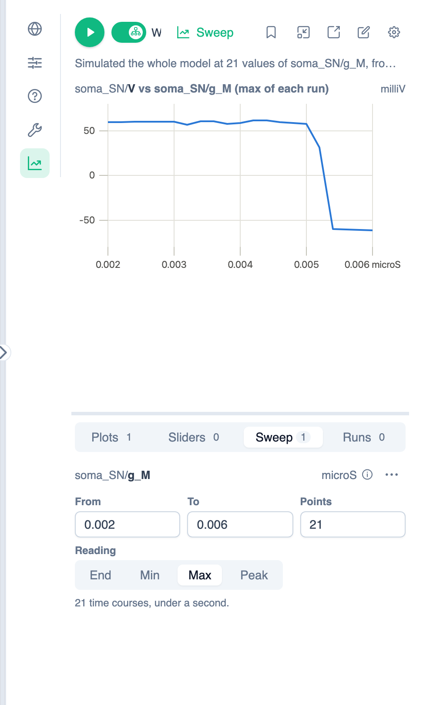

# Simulating Your Model

PhLynx runs and plots your model in-app. Three places share the same controls, and each adds its own:

| Place | Open with | Adds |
| :--- | :--- | :--- |
| **Simulation** tab, [Context Sidebar](../reference/ui-overview.md#context-sidebar) | **Simulation** (chart-line icon) on the right-hand rail | **Selection** scope, floating viewer, page link |
| **Plot** tab, [Instance Editor](../reference/ui-overview.md#instance-editor) | Editing an instance | **This instance** scope, **Auto-update** |
| `/simulation` page | **Open the simulation page** (external-link icon) in the sidebar | Run settings, run-mode switch, downloads |

The walkthroughs below use the Simulation tab and the three-instance SN model from the [Quick Start](../getting-started/quick-start-guide.md), with the default run of 0–10 s. Every control is listed in the [Simulation UI Reference](../reference/simulation-ui-overview.md).

{.align-center width="800px"}

## Running a Simulation {#running-a-simulation}

1. Open the **Simulation** tab (chart-line icon) on the right-hand rail.
2. Leave the scope switch beside Play on **Whole model**. To run only some instances, see [Simulating Part of the Model](#simulating-part-of-the-model).
3. Click **Simulate the whole model** (play icon), or press F9 while the panel has focus. A progress bar shows while it runs, and the [status line](#status-line) under the toolbar then says what ran, e.g. *Simulated the whole model.*
4. In the **Plots** view under the charts, type part of a name in **Add a variable…**, e.g. `soma V`, and pick **soma_SN/V**. Words match anywhere in the `instance/variable` path. See [Choosing What to Plot](#choosing-what-to-plot) for more.

A dot on Play means the results are out of date, for example after you edit the model or change the selection. Press Play again to update them.

### Reading the Status Line {#status-line}

The line under the toolbar says what the simulation is doing, or what needs attention. When it ends in a down arrow, click it to list the details.

| It reads | Meaning |
| :--- | :--- |
| *Loading the simulator…* | The simulator is starting, on the first run of a visit. |
| *Running…* | A run is going; the progress bar shows how far. |
| *Simulated the whole model.* (or *N instances on their own*) | The run finished. *N warnings* at the end means it ran, but something may be off: click to read them. |
| *Can’t simulate yet: N problems* | Nothing ran. Click to list the problems, e.g. *"soma_SN.Cm" needs a value.* Give the parameter a value in the instance's **Parameters** tab, then press Play. |
| *… press play to update* | The charts are out of date: the model, settings or selection changed, or they show another run. |
| An error from the solver | The run failed. Click for the solver's messages; any results up to the failure stay on the charts. Changing the solver settings in [Simulation Settings](#run-length) may help. |

An info icon on the line holds notes: things that are expected but worth knowing, such as boundary conditions using their own values when you simulate a selection. Notes don't count as warnings.

A model with no differential equations is solved once, as a **steady state**, rather than over the VoI. The status line then ends *once: without differential equations, nothing changes over time*, and each plot lists its variables' values in place of a chart.

> [!NOTE]
> A variable in `celsius` is simulated without its 273.15 K offset, because the simulator can't handle `celsius`; the run warns about it. That is only correct where the variable is used as a difference, e.g. `(T - 37)/10`. Use `kelvin` for absolute temperatures, e.g. in RT/F.

### Simulating Part of the Model {#simulating-part-of-the-model}

To check one instance or a few on their own:

- **From the canvas:** right-click an instance and choose **Simulate Instance**. If it is part of a selection, the item reads **Simulate Selection (N)** and runs every selected instance. The Simulation tab opens and runs at once.
- **From the Simulation tab:** select instances on the canvas (Ctrl/Cmd+click adds one, Shift+drag draws a box), then turn the scope switch beside Play off. It reads **Selection (N)** and runs at once. Selecting other instances later marks the results out of date; press Play to run the new selection.
- **From the Instance Editor:** in the **Plot** tab, set the scope switch to **This instance**.

> [!NOTE]
> When you simulate a selection, Sum/Multiply inputs that are cut off are dropped, with a warning. A boundary condition whose supplier is outside the selection uses its own value; that is expected, so the status line lists it under an info icon rather than as a warning. One with no value is set to 0 for that run.

### Choosing What to Plot {#choosing-what-to-plot}

In the **Plots** view:

- **Add a variable:** type in **Add a variable…** and pick from the list. With more than one plot, the **Plot to add to** box beside it picks the plot; **Add a variable here** (plus icon) on a plot does the same. A plot holds one unit, so a variable in other units goes to a plot in its units, or a new one.
- **Add plot** starts another chart.
- **Remove a line:** click **Remove from the plot** (trash icon) beside the variable.
- **Phase plot:** open the plot's **⋯** menu ▸ **Plot against a variable…**, then pick the x variable in the **Plot against…** box, e.g. plot V against an activation gate. **Plot against time again** (beside the x variable's name) goes back to the VoI.

The full list of plot controls is in the [Simulation UI Reference](../reference/simulation-ui-overview.md#plots).

### Setting the Run Length {#run-length}

1. Click **Simulation settings** (cog icon) in the Simulation tab's toolbar. It opens **Simulation Settings** on the **Solver** tab. (**Configure simulation settings** in the main toolbar opens the same dialog, on **Plots**.)
2. Under **Time course**, set **Simulation starts at** and **Ends at**. They are in the units of the model's VoI, even though the dialog says *In seconds*.
3. Set **Point interval**, the spacing between the points kept. A smaller interval gives smoother curves but more data.
4. Click **Save**. The next run uses the new settings.

**Plots start at** can be later than **Simulation starts at**, so the model settles before you look: the solver starts from the initial values, and results before **Plots start at** are solved but not kept. **Solver** defaults to CVODE; its other fields are described in the [Simulation UI Reference](../reference/simulation-ui-overview.md#simulation-settings). On the [simulation page](../reference/simulation-ui-overview.md#simulation-page), the same fields are in the folding **Simulation settings** section, and changes there apply as you make them.

## Plotting from the Math {#plotting-from-the-math}

In the Instance Editor's **Plot** tab, with **Auto-update** on (the default), click a variable in the CellML Text or Math Editor to plot it alone. Runs use the saved instance, so click **Save to include your edits** first. To plot several variables, turn Auto-update off and add them from the search. This chart isn't saved to the workspace.

## Trying Values with Sliders {#using-sliders}

A slider changes a parameter for the runs only. The model keeps its value until you apply the slider's.

1. Run the model once, then click **Sliders** in the views bar under the charts.
2. Click **Add slider** (plus icon), type `Cm` and pick **soma_SN/Cm**. Only parameters are offered, as computed values can't be set. The slider covers 10% either side of the model's value.
3. Drag the slider, or click its handle and use the arrow keys. The model reruns as it moves, and the changed value is highlighted.
4. Open the slider's **⋯** menu for:
   - **Back to the model's value**: undo the change for the runs.
   - **Apply this value to the model**: write the value into the instance. Ctrl/Cmd+Z on the canvas undoes it.
   - **Edit range…**: set its **Minimum** and **Maximum**.
   - **Remove slider**.

Sliders are saved with the workspace, and also listed in **Simulation Settings ▸ Sliders & sweep**. They are off while a protocol runs, and a parameter that is being swept shows **swept** in place of its value.

## Comparing Runs {#tracking-runs}

Track a run to keep its lines on the charts while you try other values.

1. Run the model and move a slider to the value you want to keep.
2. Click **Track this run** (bookmark icon) in the toolbar. **Runs** now shows **(1)**, and each chart's key lists **Live** (solid) and **#1** (dashed).
3. Move the slider again. The live line changes and #1 stays put.
4. Open **Runs** to manage them. Each run lists the slider values it ran with.
   - Click a run's name to rename it, then press Enter. The chart key uses the new name.
   - The eye icon hides or shows a run, including the live run once something is tracked.
   - **Stop tracking** (× icon) removes one run, and **Remove all** removes every run.

You can track up to 5 runs. Changing the scope or the kind of run (a time course, a [steady state](#status-line), or a sweep of another parameter or with another reading) clears them. A protocol run, or a sweep with a curve per value, can't be tracked; the bookmark's tooltip says why.

## Sweeping a Parameter {#sweeping-a-parameter}

A sweep runs the model once for each of a range of values of one parameter, then plots your plotted variables against that parameter:

- **A model with ODEs** runs a whole time course at each value, then takes one reading from each: its **End**, **Min**, **Max** or **Peak**. The result is, for example, V's maximum against g_M.
- **A model without ODEs** (steady-state or algebraic) is solved once at each value, so you get each variable's value as a curve against the parameter, such as an I–V curve.

To step a parameter from a holding value and read the response, use a [protocol](./running-protocols.md) instead.

### Example: When Does the M Current Silence the Soma? {#sweep-example}

With the default settings, soma_SN fires. This sweep finds the M-current conductance, g_M, above which it stops.

1. Run the whole model once and plot **soma_SN/V**, as in [Running a Simulation](#running-a-simulation). The sweep plots whatever is on the **Plots** view, and uses this run's duration for its time estimate.
2. Click **Sweep** in the views bar under the charts. It reads *No sweep yet.*
3. Click **Sweep a parameter** (plus icon), type `g_M` and pick **soma_SN/g_M**. The search only offers what a sweep can vary: constants, global constants, and boundary conditions that nothing supplies in the scope Play runs next. So a connected boundary condition can be swept when you simulate its instance on its own; in a whole-model run, the status line says it *is supplied through a connection in this run*. *Not in the last run* marks a parameter outside the current scope. The info icon beside the parameter explains what a sweep does and what an export makes of it.
4. The range starts at half the parameter's value either side, with 51 points. Set **From** to `0.002`, **To** to `0.006` and **Points** to `21`. The points are spaced evenly, ends included.
5. Under **Reading** (shown for models with ODEs), click **Max**. The line below now reads *21 time courses*, with an estimate of how long they will take.
6. Click **Run the sweep** (chart-line icon), which has appeared in the toolbar. It turns into a highlighted **Sweep** button, and the sweep runs at once.

{.align-center width="550px"}

The status line reads *Simulated the whole model at 21 values of soma_SN/g_M, from 0.002 to 0.006 microS, reading the max of each time course*, and the chart is titled **soma_SN/V vs soma_SN/g_M (max of each run)**. V's maximum stays near +60 mV while the soma fires, then drops to about −60 mV between 0.0052 and 0.0054 microS: above that, the soma stays silent.

### Choosing the Reading {#sweep-reading}

The **Reading** row appears only for models with ODEs; a model without them is solved once per value. The reading is taken between **Plots start at** and **Ends at**.

| Reading | Takes | Use it for |
| :--- | :--- | :--- |
| **End** (default) | The last value | A steady state, once the run has settled |
| **Min** | The least value | A trough, or a peak inward current |
| **Max** | The greatest value | A spike's height |
| **Peak** | The value furthest from 0, with its sign | A response that may go either way |

For a firing neuron, **Peak** picks the after-hyperpolarisation (about −87 mV here) rather than the spike, because that is further from 0. Use **Max** for spike height.

If **Simulation starts at** is earlier than **Plots start at**, to let the model settle, an info icon beside **Reading** says that the first moments aren't read.

### Changing and Rerunning {#sweep-rerun}

- Changing the range, points or reading marks the results out of date with a dot on Play. Press Play (or F9) to rerun the sweep.
- With **Sweep** on, Play always runs the sweep. Slider changes don't rerun a sweep of a model with ODEs, because it takes too long; press Play when you are ready. A sweep of a model without ODEs reruns as the slider moves.
- To compare sweeps, track one with **Track this run**, change a slider and press Play. The tracked sweep stays on the chart, dashed.
- To change the swept parameter, click the sweep's **⋯** (More for the g_M sweep) ▸ **Change parameter…**. The range and points reset, and the reading is kept.

### Adding a Curve for Each Value of a Second Parameter {#sweep-curves}

1. Click the sweep's **⋯** ▸ **Add a curve for each value of…**, type `Cm` and pick **soma_SN/Cm**.
2. In **Values**, the parameter's own value is filled in. Replace it with values separated by commas, e.g. `20, 31.8, 45`, and press Enter. The line below now reads *21 × 3 = 63 time courses*, and the view's tab shows **Sweep (2)**.
3. Press Play. Each chart draws one curve per value, in its own colour, and the key reads e.g. **soma_SN/Cm = 20 picoF**.

To go back to one curve, click the curves' **⋯** ▸ **Draw one curve**.

### Limits and Run Time {#sweep-limits}

- A sweep can have 2 to 1000 points, a second parameter up to 8 values, and 2000 runs in total. Problems are shown in the Sweep view, and in the Sweep button's tooltip.
- The line under the reading gives the run count and, after a run, an estimate of the time. Above 200 time courses it warns that the sweep will be slow. Fewer points, or a larger **Point interval**, make it quicker.
- To stop a sweep that is running, click **Stop** (square icon). The results so far stay on the chart, and the status line says where it stopped.

### Turning a Sweep Off {#sweep-off}

- Click **Sweep** in the toolbar again (tooltip *Sweeping soma_SN/g_M: switch back to one run*). Play then runs a single time course, and the sweep is kept for later.
- Click the sweep's **⋯** ▸ **Stop sweeping** to delete it.

The sweep is saved with the workspace, but the **Sweep** button starts off when you reopen it. You can also edit the sweep in **Simulation Settings ▸ Sliders & sweep**, or switch Play between **Time course** and **Sweep** on the [simulation page](../reference/simulation-ui-overview.md#simulation-page).

### Exporting Sweep Results {#sweep-export}

On the simulation page, **CSV** downloads the plotted series against the swept parameter, and **PNG** downloads the charts. **SED-ML** is off while **Sweep** is on; switch back to the time course to export the run. Web OpenCOR can't run sweeps, so an **OpenCOR** export simulates the model once, at the parameter's own value.

## Protocols {#protocols}

A **protocol** runs a set of experiments, each setting parameters and recording outputs. See [Running Protocols](./running-protocols.md).

## Floating Viewer and Simulation Page {#floating-viewer-and-simulation-page}

* **Float over the canvas** (window icon) shows the results in a small window, so you can keep building. See [Floating Viewer](../reference/simulation-ui-overview.md#floating-viewer).
* The [simulation page](../reference/simulation-ui-overview.md#simulation-page) has larger charts, the run settings and the [CSV, PNG and SED-ML downloads](../reference/simulation-ui-overview.md#downloads).
