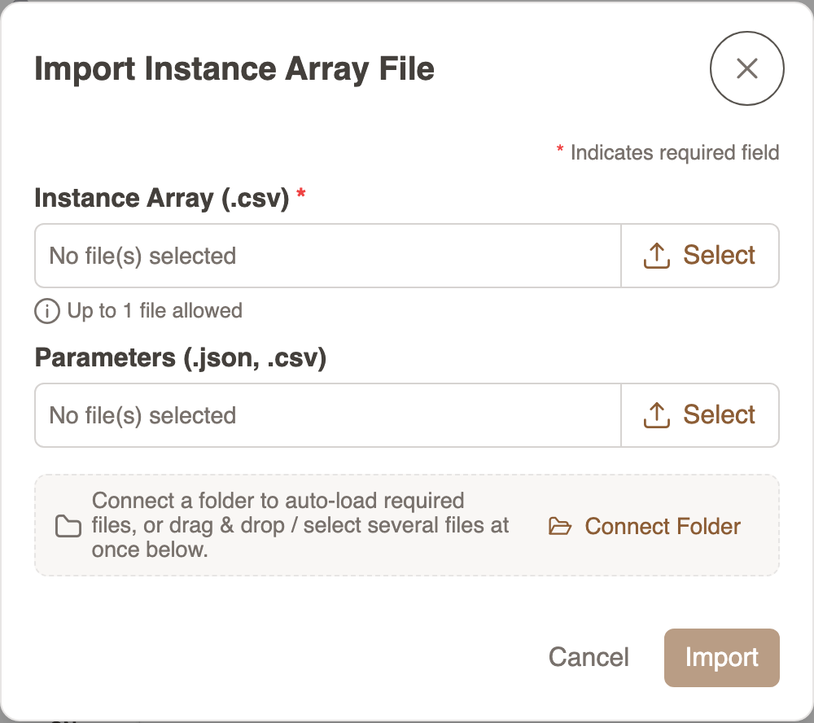

# Using PhLynx with Circulatory Autogen

PhLynx reads and writes [Circulatory Autogen](https://physiomelinks.github.io/circulatory_autogen/) (CA) configuration files, so you can edit a CA model visually and hand it back.

## Importing a CA model {#import}

1. Open the **Import** menu (arrow beside the Import button) and choose **Instance Array**.
2. In **Import Instance Array File**, select your instance array CSV and, optionally, a parameters CSV. See [Supported File Formats](../reference/file-types.md#instance-array) for the formats.
3. If module types are unknown, **Additional Files Required** lists the missing module configs and CellML components. Add them, drop their folder on the dialog, or select several files at once. In browsers that allow folder access (Chrome, Edge), **Connect Folder** loads them from a folder you choose. PhLynx remembers that folder; on a later visit it may ask you to click **Reconnect** to allow access again.

{.align-center width="550px"}

Optional `x`/`y` columns set node positions. To load values later, use **Import ▸ Parameters**; values for computed variables are skipped with a notice.

## Parameter files {#parameter-files}

**Import ▸ Parameters** reads parameter values as JSON (`"schema_version": 1`) or CSV:

- **A module's parameter set**, such as `NKA_parameters.json`: one entry per variable, plus a `global` group for global constants. Its name without `_parameters` (`NKA`) is the set's name, and it belongs to every module whose config names it as `default_parameterisation`. Imported before such a config, it waits until one arrives. Importing a set with a name already in use asks whether to **Keep both** (the new one becomes `NKA_2`), **Replace** or **Skip**.
- **A model's values**, nested by instance name: applied to those instances. Global constants it would change are listed to confirm first.
- **A CA parameters CSV** (`<variable>_<instance>` rows), as before. A CSV with a `sourced` column is read as a module's set.

New instances take their module's set over the math's own values; a set's global constants only fill ones not yet set. Entries left empty or `EMPTY_MUST_BE_FILLED` are reported as needing a value and never applied. Where the config gives a variable another type than the file does (a `Scale_*` under `global` but typed `constant`), the config's type wins and the import warns.

To use another set, choose it in **Parameters** on the module's library card before dragging; the card's preview lists its values. For a placed instance, choose it in **Parameter set** at the top of the Instance Editor's Parameters tab: PhLynx lists the values it changes, then overwrites them as one undo step; a global constant already set keeps its value. The workspace keeps the imported sets, and the CA export records each module's default and any instance's other set.

## Exporting to CA {#export}

Open the **Export** menu, choose **Circulatory Autogen**, then name the zip.

### Output {#output}

For an export named `<name>`:

| File | Contents |
| :--- | :--- |
| `<name>_module_array.csv` | Instances and their connections. |
| `<name>_parameters.json` | Constants and boundary conditions by instance and variable, global constants under `global`. Blank values are written `EMPTY_MUST_BE_FILLED`. |
| `<name>_obs_data.json` | The protocol, if the workspace has one. |
| `modules/<name>_module_config.json` | Ports, variables and units of every module used. |
| `modules/*modules.cellml` | One per CellML file used, with PhLynx edits, renamed to end in `modules.cellml` (`my_math.cellml` → `my_math_modules.cellml`). With a heart, also `zero_flow`, plus `arterial_simple:vp` when CA adds a pulmonary circuit. |
| `modules/<name>_units.cellml` | Units those components use. |

To run it, unzip it and set these entries in `user_inputs.yaml`, CA's settings file in your Circulatory Autogen checkout (see the [CA documentation](https://physiomelinks.github.io/circulatory_autogen/) for installing and running CA):

```yaml
file_prefix: <name>
resources_dir: <unzipped folder>
input_param_file: <name>_parameters.json
external_modules_dir: <unzipped folder>/modules
use_builtin_modules: false
```

`use_builtin_modules: false` stops built-in components being written twice and units clashing. For the protocol, also set `param_id_obs_path` to `<name>_obs_data.json`.

### Warnings on export

- **Missing Boundary Values:** an unconnected boundary condition has no value, so CA will ask for it.
- **Pulmonary Circuit Added:** the only heart has one output, so CA adds a pulmonary artery and vein (`par`, `pvn`) and will ask for their values.
- **Missing Units:** no library units file defines some units, so they are left out.
- **Components Renamed:** CA finds components by name, so when components in different groupings share a name, the export keeps the name for one (a CellML grouping first) and renames the others after their grouping, such as `decay` in `User_Modules.celldl` → `decay_celldl` (numbered, `decay_celldl_2`, if that's taken). Only the export changes; the library keeps both names. Importing the export brings the components back as CellML under the exported names, such as `User_CellDL_modules.cellml:decay_celldl`.
