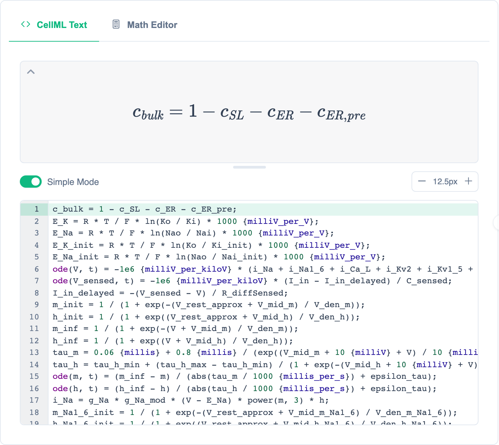
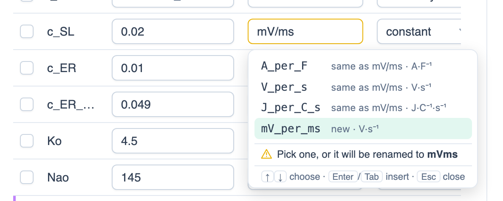
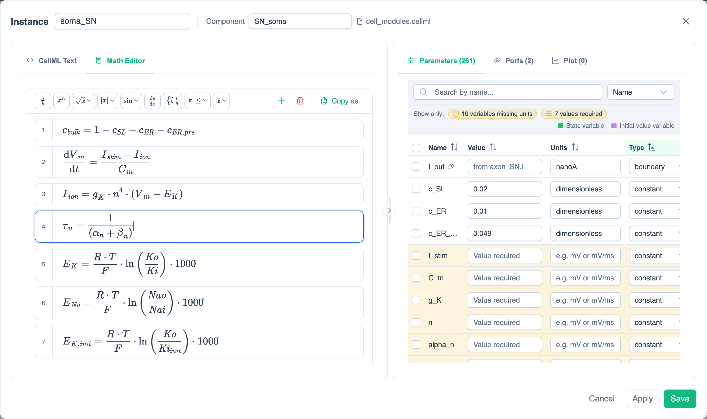

# Writing CellML Guide

PhLynx modules are written in <GlossaryLink term="CellML"/>, a model format that checks units for consistency. You edit them as **CellML Text**, a code-like syntax (`a = b + c;`) that PhLynx converts to CellML XML, or as typeset maths in the [Math Editor](#math-editor).

## Opening the Editor

Double-click a node, or click its **Edit instance** (pencil icon) button, to open the Instance Editor. Its left pane has two tabs that edit the same equations:

{.align-center width="600px"}

| Tab | What it does |
| --- | --- |
| **CellML Text** (code icon) | Text editor with a **Simple Mode** toggle and font-size buttons. The equation preview above it renders the line under the cursor and lists parse errors by line; you can collapse or resize it. |
| **Math Editor** (calculator icon) | Shows the equations as typeset maths that you edit in place, with a toolbar. Always in Simple Mode. See [Using the Math Editor](#math-editor). |

If one tab can't show part of the math, it points you to the other. While the right pane shows the **Plot** tab with **Auto-update** on, clicking a variable in the math plots it. For the rest of the dialog (Parameters, Ports, Plot), see [Interface Overview](../reference/ui-overview.md#instance-editor).

### Simple Mode vs. Advanced Mode

| | Simple Mode (default) | Advanced Mode (Simple Mode off) |
| --- | --- | --- |
| Text holds | Equations only | The whole model: `def model`, `def comp`, `var` lines and equations |
| Variables declared in | The **Parameters** tab, kept in step for you | The text |
| Component name set in | The dialog header | The text (`def comp [name] as`) |

PhLynx remembers which mode you last used. In Simple Mode, if you rename a variable that is still used elsewhere, a notice offers **Rename all** or **Keep both**.

### Saving

- **Save** writes the math back to the component's file and closes the editor; **Apply** saves and keeps it open. PhLynx asks before overwriting an existing component (**Overwrite Math?**).
- If other instances use the same component, tick **Apply math changes to all N instances** to update them too.
- Built-in templates can't be overwritten; PhLynx asks for a new name (**Save As New Component**).

## Units {#units}

Every variable needs units, and both sides of each equation must have matching units. PhLynx keeps one shared **units library**: CellML's built-in units (`volt`, `second`, `mole`, …), PhLynx's own units files, and any units you import or create. Modules refer to library units by name, so they don't need to define their own.

### Give a variable units {#set-units}

You set units in the right pane's **Parameters** tab. Its **Units** fields can be edited in Simple Mode, which is always on in the Math Editor.

1. Open the Instance Editor and click the **Parameters** tab.
2. To find the variable, type its name in **Search by name...**.
3. Click the variable's **Units** field (it shows *e.g. mV or mV/ms* when empty) and start typing, for example `mV`. A list of library units whose names contain what you typed opens below the field, each with its definition (`mV  10⁻³ V`).
4. Press ↓ or ↑ to highlight one, then press Enter or Tab, or click it. Esc closes the list and keeps what you typed.

If you change the units of a state variable, its initial-value variable gets the same units, and the other way round.

> [!TIP]
> **Settings** (cog icon) ▸ **Units suggestion format** chooses how definitions are shown: **CellML built-in units** (`mV = 10⁻³ V`, the default) or **SI base units** (`mV = 10⁻³ kg·m²·s⁻³·A⁻¹`).

### Create a unit from an expression {#create-units}

If the library doesn't have the units you need, type them as an expression and PhLynx offers to create them. For example, to give a rate of change of voltage the units mV/ms:

1. In the variable's **Units** field, type `mV/ms`.
2. The list shows:
   - any library units equal to it, marked **same as mV/ms** (here `A_per_F`, `V_per_s`, …), and
   - a new unit, `mV_per_ms`, marked **new · V·s⁻¹**.
3. Press ↓ until `mV_per_ms` is highlighted, then press Enter, or click it. The field now reads `mV_per_ms`.
4. Click **Save** or **Apply**.

{.align-center width="500px"}

A unit marked **same as** is identical to the expression, so picking it adds nothing to the library. When the list opens, its first item is already highlighted, so Enter on its own picks that item, which may not be the new unit.

Write expressions in UCUM notation, the units syntax used by many lab and medical systems:

| To | Write | Example |
| :--- | :--- | :--- |
| Divide | `/` (read left to right) | `mV/ms`, `mL/min/kg` |
| Multiply | `.` (not `*`) | `N.m` |
| Raise to a power | the exponent straight after the symbol (not `^`) | `cm2`, `m3`, `s-1` |
| Group | `( )` | `mmol/(L.s)` |
| Scale by a power of ten | `10*n` | `10*3/uL` |
| Add a prefix | a prefix letter before a metric symbol: `p` pico, `n` nano, `u` micro, `m` milli, `c` centi, `k` kilo, `M` mega | `uA/cm2`, `kPa` |

You can use the SI symbols (`m`, `g`, `s`, `A`, `K`, `mol`, `L`, `V`, `F`, `S`, `Ohm`, `Pa`, `J`, `W`, `C`, `N`, `Hz`, …), `min`, `h` and `d` for time, `mmHg`, `cmH2O` and `%`, as well as any library unit's name. `M` is the mega prefix, not molar: write `mmol/L`, or use the library's `millimolar`. Don't type spaces.

**Name.** PhLynx names the new unit from the symbols you typed: those on top are joined with `_`, each one below the line adds `_per_`, and exponents stay as digits. So `mV/ms` becomes `mV_per_ms`, `uA/cm2` becomes `uA_per_cm2`, and `10*3/uL` becomes `kilo_per_uL`. If a different unit already has that name, PhLynx adds `_1`.

**Storage.** As soon as you pick the new unit, PhLynx adds it to the units library, in a units file called `generated_units.cellml`. It's defined in CellML's built-in units, so `mV_per_ms` is millivolt per millisecond. The unit stays in the library even if you then click **Cancel**. Any module can use it, including in numbers such as `2 {mV_per_ms}` in CellML Text. It's saved with the workspace and included in exports.

### Fix missing or unknown units {#missing-units}

Above the table, **Show only:** has a chip for each kind of problem:

- **N variables missing units**: the variable's **Units** field is empty.
- **N units not in library**: the units name isn't defined in the library. The field shows a warning triangle. Hover over it to see *"x" isn't defined in the units library*.

1. Click a chip to show only the affected rows. Click it again to show all rows.
2. In each row, type the units, or an expression for them, and pick an item from the list.
3. If you need a unit that an expression can't make, import a units file (see [Limits](#units-limits)).

If you leave the field without picking from the list, PhLynx keeps what you typed as a units name. It turns the text into a valid name using only letters, digits and underscores, so `mV/ms` becomes `mVms`, which isn't in the library. The list warns you about this (*Pick one, or it will be renamed to mVms*).

### Limits {#units-limits}

- **Advanced Mode:** the **Units** fields are read-only, because the text declares the units. To create a unit, turn **Simple Mode** on, create the unit, then turn Simple Mode off again and use its name in the text.
- **No new unit offered:** if the list offers neither a new unit nor a **same as** unit for an expression, PhLynx couldn't read it. Check it for spaces, `*`, `^` or a symbol PhLynx doesn't know.
- **Temperatures:** you can pick `Cel` (celsius) or `degF` (fahrenheit) on their own, but you can't combine them with other units.
- **Units files:** units with their own base units can't be made from an expression. To use them, import a units file. See [CellML Units File](../reference/cellml-units-file.md).

## Writing Equations

Every equation ends with `;`, and both sides must have matching units.

| Kind | Syntax |
| --- | --- |
| Operators | `+`, `-`, `*`, `/` |
| Functions | `sin`, `cos`, `exp`, `sqrt`, `power`, `abs`, `min`, `max`, `ln` (natural log), `log` (base 10) |
| Number with units | `2 {mV}` (no units means dimensionless; the units must be in the [library](#units)) |

```bash
// Ohm's law for fluid flow
flow = (u_in - u_out) / R;

// Area from a radius
area = 3.14159 * power(radius, 2);
```

### Ordinary Differential Equations (ODEs)

`ode(variable, VoI)` is the derivative of a variable with respect to the variable of integration (VoI):

```bash
// Rate of change of volume V with respect to t
ode(V, t) = flow_in - flow_out;
```

- The second argument is the VoI, whatever its name (`t`, `time`, `tau`) or units. Simple Mode adds its row to the Parameters tab; in Advanced Mode, declare it yourself (`var t: second;`).
- On export, every module's VoI is connected to one `environment` variable, which takes its name and units from the first ODE's VoI (e.g. `environment/time` in seconds). If a module's VoI is in units that can't convert to the environment's, such as metres against seconds, export stops with an error naming it.
- A module without ODEs that needs the VoI, such as a stimulus, can declare `t` or `time` in time units, and PhLynx connects it as well.

#### Set a starting value {#initial-values}

Each variable inside `ode(...)` is a **state variable** and needs a starting value. In Simple Mode the state takes it from another variable, its **initialiser**, so that the value can be a parameter like any other (in a parameter file, a slider or a sweep). On the **Parameters** tab, states have a green stripe (**State variable**) and initialisers a purple one (**Initial-value variable**).

1. After you write `ode(V, t)`, PhLynx adds a constant `V_init` and makes it `V`'s initialiser. Type the starting value in the **Value** of the `V_init` row. You can rename `V_init` in its **Name** box.
2. To start `V` from an existing variable instead, open `V`'s **Value** dropdown (*Which variable supplies this state's initial value*) and pick it. It lists the constants, global constants, boundary conditions and computed constants with the same units as `V`. **New (V_init)** makes a fresh initialiser.
3. An initialiser shared by several states shows a count badge, for example **x2**. Hover it to see which states use it.

If you switch a state away from an initialiser that has a value and that no other state or equation uses, PhLynx asks **Switch initialiser?** before deleting it and its value: **Proceed** deletes it, **Revert** keeps the old choice. In Advanced Mode, set the starting value with `init` in the `var` line instead; see [Advanced Mode](#advanced-mode).

### Algebraic Systems

A model with no ODEs has no VoI and is solved once, so its plots list each variable's value. To see a curve, sweep a parameter; see [Sweep](../reference/simulation-ui-overview.md#sweep). To plot one variable against another, see [Plots](../reference/simulation-ui-overview.md#plots).

```bash
// A lever: the load moved for a given effort
load = effort * arm_ratio;
```

### Conditional Logic (Piecewise) {#piecewise}

Use a `sel` block:

```bash
x = sel
    case [condition]: [value_if_true];
    otherwise: [value_if_false];
endsel;
```

```bash
// A valve: flow only from high to low pressure
flow = sel
    case u_in > u_out: (u_in - u_out) / R;
    otherwise: 0 {m3_per_s};
endsel;
```

## Using the Math Editor {#math-editor}

The Math Editor shows each equation as typeset maths that you edit in place, as in a word processor's equation editor. It edits the same equations as CellML Text, and you can switch between the two tabs at any time. Like Simple Mode, it holds only the equations; the **Parameters** tab declares the variables.

{.align-center width="800px"}

### Write an equation {#math-editor-start}

The steps below write the ODE dV_m/dt = (I_stim − I_ion)/C_m.

1. In the Instance Editor, click the **Math Editor** tab (calculator icon) at the top of the left pane. Each equation is shown on its own numbered line, below the toolbar.
2. Click the line after which you want the new equation, press End, then press Enter. You can also click **Add equation line** (+) in the toolbar.
3. Type `\dd` and press Space. This inserts a derivative, d☐/d☐, with the cursor in its top slot.
4. Type `V_m`, press Tab to move to the bottom slot, and type `t`. The bottom variable is the VoI.
5. Press Space to leave the derivative, then type `=(I_stim-I_ion)/C_m`. The `/` turns the bracketed text into the numerator of a fraction and moves the cursor to the denominator.
6. Press Enter to finish the line. Any new variables appear in the **Parameters** tab marked **Value required**. Give each one a value and [units](#set-units).
7. Click **Save**, or press Ctrl/Cmd+Enter.

A few rules decide how your typing is read:

- **Names:** letters typed together make one name, so `Vm` is one variable, not V × m. To multiply, type `*`, which is shown as ·. A number or a closing bracket before a name also multiplies: `2V`, `(a+b)c`.
- **Subscripts:** an underscore in a name draws a subscript, so `C_m` is shown as C with the subscript m, and `g_K__max` adds the superscript max. The variable is still called `C_m`.
- **Greek letters:** a name that spells a Greek letter is drawn as the letter, so `alpha_n` is shown as α with the subscript n.
- **Slots:** what you type goes into the slot the cursor is in, which is tinted blue. Press Space, or → at the end of the slot, to step out before you carry on.

### What to type {#math-editor-input}

| To get | Type |
| :--- | :--- |
| Product a · b | `a*b` |
| Fraction | `a/b` (the numerator is the term before `/`, so `(x+1)/2` puts x + 1 on top) |
| Power x² | `x^2`, then Space |
| Square root, nth root | `\sqrt` or `\root`, then Space |
| Absolute value \|x\| | `\|x\|` |
| Functions | `sin(x)`, `exp(x)`, `ln(x)`, `log(x)`, `log(x,2)` (base 2), `min(a,b)`, `max(a,b)`, `floor(x)` |
| Derivative dV/dt | `\dd`, then Space, `V`, Tab, `t`, Space |
| Number with units | `0.25{mV`, then Space. The units are hidden afterwards. To see them, hover over the number. |
| Scientific notation | `1e-3` |
| π, e | `\pi`, `\e` |
| ≤ ≥ ≠ | `<=`, `>=`, `!=` |
| and ∧, or ∨, not ¬ | `&`, `\or`, `!` |
| Piecewise | `\cases`, then Space (see below) |

**Commands:** type `\` to open a list of commands, such as `\sqrt`, `\dd` and `\alpha`. Keep typing to narrow the list. Press ↑ or ↓ to choose a command and Tab to insert it, or press Space to use the command exactly as typed. Esc closes the list.

**Toolbar:** the buttons insert the same things. From left to right, they are **Fraction**, **Power**, **Roots**, **Absolute value, floor and ceiling**, **Functions**, **Derivative**, **Piecewise**, **Operators, constants, relations and logic** and **Accents and charges**. After them come **Add equation line** (+), **Remove equation line** (trash icon) and **Copy as**, which copies the equation as LaTeX, MathJSON, Content MathML or a Word equation.

**Piecewise:** `\cases` inserts one case and an *otherwise* row with the value `0.0`, and places the cursor in the first value.

1. Type the value, press → to move to its condition, and type the condition, for example `t>=5{ms`.
2. To add another case below, press Enter.
3. To change the otherwise value, type over `0.0`. To remove the otherwise row, delete its contents, then press Backspace again.

While the otherwise value is still `0.0`, it takes the units of the first case's value. In CellML Text, a piecewise is written as a [`sel` block](#piecewise).

### Keyboard shortcuts {#math-editor-keys}

The keys for moving, selecting and editing are listed in [Keyboard Shortcuts](../reference/keyboard-shortcuts.md#math-editor). Undo is Ctrl/Cmd+Z (redo Ctrl/Cmd+Shift+Z or Ctrl/Cmd+Y), and Ctrl/Cmd+Enter saves and closes.

- **Undo:** the Math Editor shares its undo history with CellML Text. Each undo step is one edit, and an edit ends when you pause typing, press Enter or move to another line.
- **Esc:** if there's no list or selection to close, Esc closes the Instance Editor. If you have unsaved changes, PhLynx asks first.
- **Paste:** you can paste LaTeX, plain maths (`y = (x+1)/2`), Content MathML from a CellML model, or equations copied from Word's equation editor. Numbers pasted from Word come in without units.

### Switch to CellML Text {#math-editor-switch}

To switch, click the **CellML Text** tab. A derivative is shown there as `ode(V_m, t)`, a piecewise as a `sel` block, and `0.25{mV}` as `0.25 {mV}`. If a line has a problem, it gets a red outline and a wavy underline; hover over it to see what's wrong. If you switch while a line has a problem, PhLynx asks **Discard Invalid Edits?**: click **Switch** to lose the edits made since the math was last valid, or **Cancel** to stay. Next time you open the Instance Editor, it shows the tab you used last.

### Limits {#math-editor-limits}

- **Not supported:** higher-order derivatives, integrals, sums, functions of your own (`f(x)` is read as f × x) and chained comparisons. Instead of `0<x<1`, write `0<x & x<1`.
- **Reserved names:** function names such as `min`, `max`, `rem` and `floor` can't be used as variable names. Longer names that contain them, such as `Vmax` and `cost`, are fine.
- **Unsupported math:** if a component's math includes something the Math Editor can't show, it locks every line and says *The Math Editor can't edit this component. Use the CellML Text tab.*

## Advanced Mode {#advanced-mode}

In Advanced Mode the text is the whole model, wrappers included:

```bash
def model [model_name] as
    def comp [component_name] as
        [variable declarations]
        [equations]
    enddef;
enddef;
```

Declare every variable before you use it:

```bash
var [name]: [units] {init: [value], interface: [public]};
```

```bash
var R: Js_per_m6 {init: 8.5};                     // constant
var u_e: J_per_m3 {init: 150, interface: public};
var flow: m3_per_s;                               // calculated
```

- `init`: starting value. Constants and state variables need one.
- `interface`: CellML visibility, `public` by default. Ports are set in the **Ports** tab, not here.
