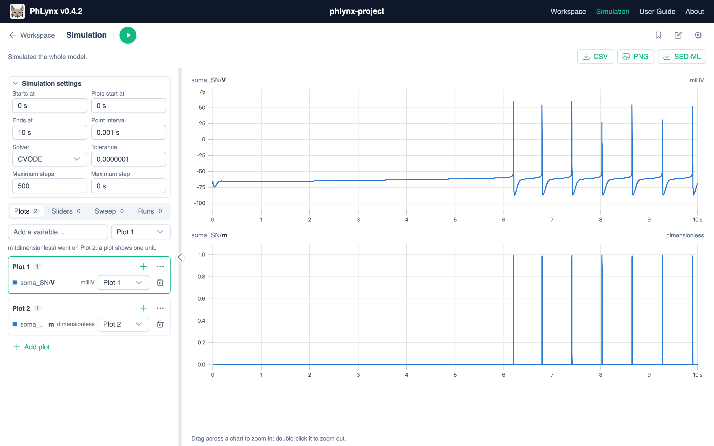

# Simulation UI Reference

Every Simulation panel control. For a walkthrough, see [Simulating Your Model](../guides/simulating-your-model.md).

## Toolbar {#toolbar}

| Button (tooltip) | Purpose |
| :--- | :--- |
| **Play / Stop** (triangle / square) | Runs or stops (F9). The tooltip says what runs, e.g. **Simulate the whole model**. A dot means results are out of date. |
| Scope switch | **Whole model** or **Selection** (sidebar) / **This instance** (Plot tab). |
| **Run the protocol's experiments** (checklist icon) | Shown when a protocol is loaded. See [Running Protocols](../guides/running-protocols.md). |
| **Run the sweep** (chart-line icon) | Shown when a sweep is set. |
| **Track this run** (bookmark icon) | See [Tracked Runs](#tracked-runs). |
| **Float over the canvas** (window icon) | Sidebar only. Opens the [floating viewer](#floating-viewer). |
| **Open the simulation page** (external-link icon) | Sidebar only. |
| **Edit obs_data** (pen-to-square icon) | Opens the protocol editor. |
| **Simulation settings** (cog icon) | Opens [Simulation Settings](#simulation-settings) on Solver. |

The protocol and sweep buttons switch what Play runs, and run it.

The **status line** under the toolbar says what ran, or why nothing did (*Can’t simulate yet: N problems*). When it shows a down arrow, click it to list the problems, warnings or solver messages. See [Reading the Status Line](../guides/simulating-your-model.md#status-line).

## Controls {#controls}

Views: **Plots**, **Sliders**, **Sweep**, **Runs**. Search matches every typed word in an `instance/variable` path.

### Plots {#plots}

- Search to add a variable to the chosen plot. A plot holds one unit; other units go to a matching or new plot.
- **Add plot**; ⋯ menu: **Rename**, **Move up**, **Move down**, **Remove plot**.
- **Phase plots:** ⋯ ▸ **Plot against a variable…**; **Plot against time** returns to the VoI, whatever it is.
- **Zoom:** drag in, double-click out. Charts zoom together; hold Shift for one.

### Sliders {#sliders}

- **Add slider**. Moving one reruns the model.
- ⋯ menu: **Back to the model's value**, **Apply this value to the model**, **Edit range…**, **Remove slider**.
- **swept** marks the swept parameter. Sliders are off during a protocol.

### Sweep {#sweep}

**Sweep a parameter**: a constant, global constant, or boundary condition nothing supplies in the scope Play runs next (a connected one can be swept when its instance runs on its own). Results plot against it. The info icon explains sweeps and their exports.

- **From / To / Points:** 2 to 1000 points.
- ⋯ ▸ **Add a curve for each value of…** a second parameter (up to 8 values; 2000 runs max). ⋯ also has **Change parameter…** and **Stop sweeping**.
- **Reading** of each time course (shown for ODE models only): **End** (default), **Min**, **Max** or **Peak** (the value furthest from 0).
- Shows the run count and a time estimate; warns above 200 time courses.
- The SED-ML download is off while sweeping. Other exports run the model once, at the parameter's own value.

### Tracked Runs {#tracked-runs}

- Up to 5. Not for protocol runs or sweeps with curves. Cleared when the scope or the run type changes (time course, <GlossaryLink term="steady-state" label="steady state"/>, another sweep).
- In **Runs**: rename, hide or remove runs; hide the live run.

## Simulation Page {#simulation-page}

{.align-center width="800px"}

- Open it from **Simulation** in the top navigation, or **Open the simulation page** (external-link icon) in the Simulation tab. **Workspace** (arrow icon) goes back.
- Runs the whole model.
- When a protocol or sweep is set, a **Time course / Protocol / Sweep** switch on the bar under the toolbar sets what Play runs, and runs it.
- The **CSV**, **PNG** and **SED-ML** [downloads](#downloads) are on the same bar.
- The controls panel resizes and collapses. Its folding **Simulation settings** section holds the [Solver tab's](#simulation-settings) fields (the first is **Starts at**); changes there apply as you make them.

## Floating Viewer {#floating-viewer}

One plot at a time (picker, or **New plot**), with **Edit this plot's variables**, scope, Play/Stop, **Sliders**, **Track this run** and **Back to the Simulation tab**.

## Simulation Settings {#simulation-settings}

From the cog (opens on **Solver**) or the main toolbar's **Configure simulation settings** (opens on **Plots**). Tabs: **Plots**, **Sliders & sweep**, **Solver**. Changes apply on **Save**. Steps: [Setting the Run Length](../guides/simulating-your-model.md#run-length).

| Solver tab field | Meaning |
| :--- | :--- |
| **Simulation starts at** | Where the solver starts, from the initial values. Times are in the VoI's units, though the dialog says *In seconds*. |
| **Plots start at** | Results before this are solved but not kept, so the model can settle first. |
| **Ends at** | Where the run ends. |
| **Point interval** | The spacing between the points kept. |
| **Solver** | CVODE (default), Forward Euler, Heun, Second-order Runge–Kutta or Fourth-order Runge–Kutta. |
| **Tolerance**, **Maximum Steps**, **Maximum Step** | CVODE only: the relative and absolute tolerance; the steps allowed between two output points; the largest step (0 for no limit). |
| **Time Step** | Fixed-step solvers only: the step size. |

Web OpenCOR doesn’t support a later **Plots start at**, so an export may not match.

## Downloads {#downloads}

Only on the simulation page:

- **CSV:** every plotted series.
- **PNG:** the charts as one image (not for steady state).
- **SED-ML:** zip of the run, its plots and the CellML model. When disabled, its tooltip says why.
