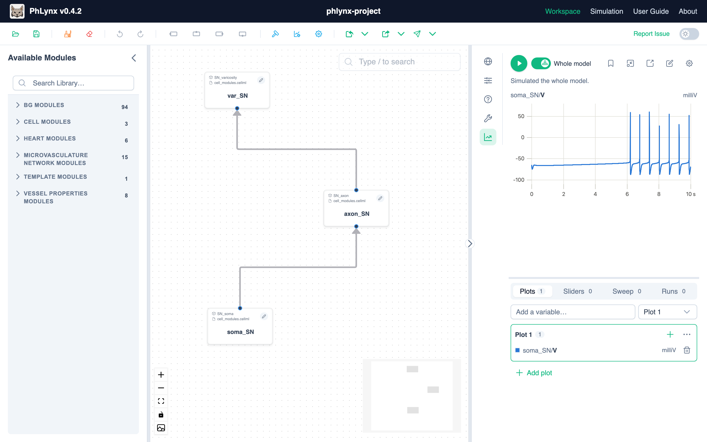
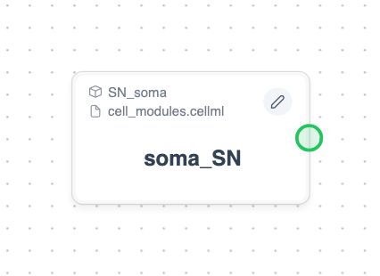
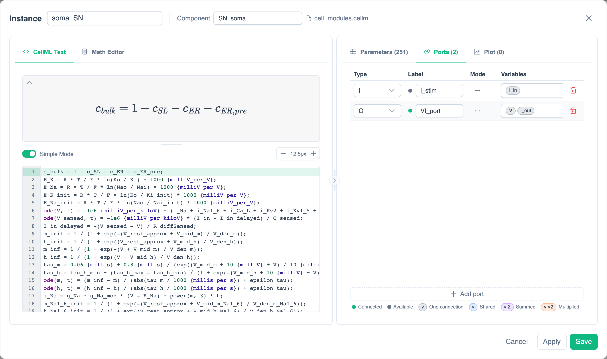

# Interface Overview

The top nav switches between **Workspace**, **Simulation** ([simulation page](./simulation-ui-overview.md#simulation-page)), **User Guide** and **About**. The Workspace view has four areas: the **[Toolbar](#toolbar)** (top), **[Available Modules](#module-library)** (left, your <GlossaryLink term="modules"/>), the **[Workspace canvas](#workspace)** (centre) and the **[Context Sidebar](#context-sidebar)** (right).

{.align-center width="800px"}

For shortcuts, see [Keyboard Shortcuts](./keyboard-shortcuts.md).

---

## Toolbar {#toolbar}

{.align-center width="800px"}

| Button (tooltip) | Icon | What it does |
| :--- | :--- | :--- |
| **Load workspace** | Folder | Opens a saved `.json` [workspace file](./file-types.md#workspace-file), replacing the canvas without asking. |
| **Save workspace** | Floppy disk | Saves to `.json`, including simulation settings (Ctrl/Cmd+S). PhLynx doesn't autosave. |
| **Clean up workspace** | Dustpan | Auto-arranges the instances. |
| **Clear workspace** | Eraser | Removes everything from the canvas (undoable). |
| **Undo** / **Redo** | Arrows | Edit history. |
| **Add left / top / right / bottom handle** | Box with a dot on that side | Adds a handle (where arrows attach) on that side of the selected instances. |
| **Open macro builder** | Hammer | Opens the [Macro Builder](../guides/macro-build-guide.md). |
| **Configure simulation settings** | Chart with cog | Opens [Simulation Settings](./simulation-ui-overview.md#simulation-settings). |
| **Settings** | Cog | Opens app [Settings](#settings). |
| **Import** / **Export** / **Send** | Split buttons | Click runs the last-used item (Ctrl/Cmd+I, Ctrl/Cmd+E); the arrow opens the menu. |

On the right are **Report Issue**, the **Diagram** / **Physiology** switch and a light/dark switch. **Physiology** draws the workspace as cells, membranes and transporters; see [Physiological View](../guides/physiological-view.md). Where supported (e.g. Chrome), saving and exporting ask where to put the file.

### Import {#import}

| Menu item | File | Result |
| :--- | :--- | :--- |
| **Instance Array** | `.csv` | Builds a connected model from an [instance array](./file-types.md#instance-array), asking for any missing module files. |
| **CellML File** | `.cellml` | Adds its components to Available Modules and its [units](./cellml-units-file.md) to the units library. If one file's components are connected to each other, it is also built on the canvas; a non-empty canvas asks **Overwrite** or **Add to Workspace**. See [CellML Module Format](./cellml-module-format.md). |
| **Module Config** | `.json` | Loads [module configurations](./file-types.md#module-configuration). |
| **Parameters** | `.csv` | Fills parameter values from a [parameter file](./file-types.md#parameter-file). |
| **Annotations** | `.ttl` sidecars; `.ttl` or `.rdf` instance file | Applies module sidecars and an instance file in the **Apply Annotations** dialog; they place instances in the [physiological view](../guides/physiological-view.md#roles). |
| **COMBINE Archive** | `.omex` | Restores a model with any protocol or [`params_for_id.csv`](./file-types.md#params_for_idcsv). |

You can also drop `.cellml` or `.omex` files onto the canvas ([Opening files](./file-types.md#opening-files)).

### Export and Send {#export}

| Menu item | Output |
| :--- | :--- |
| **CellML** (default) | Flattened CellML 2.0 model, with a link to open it in OpenCOR. |
| **Circulatory Autogen** | `.zip` of CA input files; see [Using PhLynx with Circulatory Autogen](../guides/use-with-circulatory-autogen.md#export). |
| **OpenCOR** | `.omex` with plots, settings and any parameter scan, with a link to open it in Web OpenCOR. |
| **CUFLynx** | `.omex` for CUFLynx. |
| **CellML (selection)** / **OpenCOR (selection)** | The same, for the selected instances only; warns if the selection is incomplete. |

**Send** (paper-plane icon) opens the model, or the selection, straight in Web OpenCOR without saving a file.

---

## Available Modules {#module-library}

Modules are grouped by source file. **Search Library…** filters them; drag a card onto the canvas to place an instance.

* Each card has a module picker, a config picker when there are several, **Preview configuration** (eye icon) and **Remove module** (cross icon).
* **Hide module library** (chevron) collapses the panel; drag its edge to resize.

---

## Workspace canvas {#workspace}

| Action | How |
| :--- | :--- |
| Pan / zoom | Drag empty canvas / scroll wheel or pinch |
| Select | Click; Ctrl+click (Cmd+click on Mac) adds; Shift+drag draws a box |
| Rename an instance | Click its name |
| Open the Instance Editor | Double-click an instance, or click **Edit instance** (pencil icon) |
| Right-click the canvas | **Create Module**, **Select All**, **Fit View**, **Clear Workspace** |
| Right-click an instance | **Replace Module**, **Simulate Instance** (or **Simulate Selection (N)**) |

**Replace Module** swaps an instance's math and variables for another module's, keeping its name, position and arrows. Pick the module in the list and click **Confirm**. Parameter values become the new module's. Ports are dropped unless you tick **Retain matching ports?**, which keeps each port whose variables all exist in the new module; double-click the arrows afterwards to check their couplings. Undo (Ctrl/Cmd+Z) reverses it.

**Controls** (bottom-left): zoom, fit view, lock, and **Export image** (picture icon), which saves the view as PNG or SVG ([Settings](#settings)). A minimap sits bottom-right.

### Searching the workspace {#search}

The search box at the top of the canvas (`Type / to search`) finds instances in a large model. It has two modes.

| Mode | Type | Finds |
| :--- | :--- | :--- |
| **Name** (default) | Any text, e.g. `aorta` | Instances whose name, component or source file contains the text. |
| **var:** | `var:` then a variable name, e.g. `var: q_C` | Instances holding a variable whose name contains every word you type. `var: aorta/q` looks only in instances whose name contains `aorta`. |

1. Press / or Ctrl/Cmd+F, or click the box. With the box empty, a list offers the two modes; ↑ / ↓ and Enter pick one, or just start typing for a name search.
2. Type your term. Matching instances are outlined and the rest fade. The list under the box counts them; in **var:** mode each entry shows up to three matching variables, labelled **parameter**, **global**, **boundary** or **state** where it applies.
3. Press Enter to zoom to the first match, then Enter / Shift+Enter or ↓ / ↑ to step through the rest. Clicking an entry zooms to it.
4. Press Esc, or click empty canvas, to clear the search. Esc in an empty box leaves it.

---

## Instance nodes {#module-nodes}

{.align-center width="400px"}

Each node shows its name, component (box icon), source file (file icon) and **Edit instance** (pencil icon).

A warning triangle (tooltip **At least one parameter has not been assigned a value**) means a constant or global constant has no value; boundary conditions don't count. Newly placed modules often show it. Until it is fixed, CellML and OpenCOR export fail with *Missing parameter values* and the model won't simulate. To fix it:

1. Click **Edit instance** (pencil icon); the editor opens on the [Parameters tab](#parameters-tab).
2. Click the **values required** chip to list only the empty rows, and type a value in each. Global constants can also be set in the Context Sidebar's **Global parameters** tab.

To fill many at once, use Import ▸ **Parameters** ([parameter file](./file-types.md#parameter-file)).

---

## Connections {#connections}

Handles are the dots where arrows attach. They don't decide which variables an arrow shares; ports do, set on the [Ports tab](#port-definitions) or in the Connections dialog.

* **Add a handle:** hover a node's edge and drag from the green placeholder handle, or use the toolbar's **Add … handle** buttons.
* **Connect:** drag from one handle to another. The arrow's direction is used in instance array exports.
* **Edit couplings:** double-click an arrow to open the [Connections dialog](./valid-port-configurations.md#connections-dialog).
* **Delete:** select an arrow and press Delete or Backspace. Hover a handle and click its trash icon to remove it and its arrows.

One arrow runs in each direction between two instances, and it holds all their couplings. Drawing a second arrow from A to B asks whether to replace the first (**Connection already exists**). To share more variables, double-click the existing arrow and couple more ports there.

An orange arrow with a warning badge has couplings that can't be exported: for example, Sum or Multiply ports with different numbers of variables, a pair that is Sum (or Multiply) on both ends, or a pair of variables whose units have different dimensions (e.g. second and metre; millisecond and second is fine, as it only differs in scale). Hover the badge for the reason, then double-click the arrow to fix it: the Connections dialog draws a pair with incompatible units as an orange line and lists why below it. Until then the model won't export or simulate. See [Ports that take several connections](./valid-port-configurations.md#multiports).

---

## Instance Editor {#instance-editor}

The header holds the **Instance** name (unique), the **Component** name and the source file.

{.align-center width="800px"}

* **Left pane:** **CellML Text** or **Math Editor**, two views of the same equations; see [Writing CellML](../guides/writing-cellml.md).
* **Right pane:** **Parameters**, **Ports** and **Plot** tabs (collapsible, resizable).
* **Footer:** **Cancel**, **Apply** (save and keep editing) and **Save** (Ctrl/Cmd+Enter). **Apply math changes to all N instances** also updates instances sharing the component.

### Parameters tab {#parameters-tab}

Lists every variable of the instance with its **Name**, **Value**, **Units** and **Type**. The **Instance parameters** tab in the Context Sidebar edits the same values without opening the editor.

| Type | Meaning | Value cell |
| :--- | :--- | :--- |
| **constant** | A value for this instance only. | Required. |
| **global** | A global constant: one value shared by every instance with a variable of that name. | Required; edits the shared value, also shown in the **Global parameters** tab. |
| **variable** | Computed by the module's equations. | None (`-`), except an ODE state's initialiser picker (see **Initial values** below); the type can't be changed. |
| **boundary** | A boundary condition: an input supplied through a port connection. | Optional; used only if no connection supplies it. |

The Type list is greyed out on rows the math computes or the CellML text initialises.

**Set values:** type a number in each **Value** cell, then click **Apply** or **Save**.

**Initial values:** an ODE state's Value cell picks which variable supplies its initial value; the default, **New (…)**, adds an initial-value row (coloured as **Initial-value variable** in the legend), where you type the number. To share one initial value between states, pick the same variable for each.

**Make a global constant:** set a row's Type to **global**, or tick several rows and use **N selected. Set type: … Apply**. If no global constant of that name exists yet, the row's value becomes the shared one; otherwise it takes the existing value. Change it later on either tab.

Chips above the table count problems; click one to show only those rows, and hover a row's icons for details.

| Chip | Means | Fix |
| :--- | :--- | :--- |
| **N values required** | Constants or global constants with no value. | Enter values. |
| **N boundary conditions not connected** | Nothing supplies them and they have no value. | Connect a supplier, or enter a value. |
| **N values ignored on export** | A connection sets this variable (or it is a Sum with nothing connected, so it is 0); the value you typed isn't used. | Nothing, unless you meant this instance to set it. |
| **N states with time-varying initialiser** | A state's initial value comes from a variable that changes over the VoI. | Pick a constant initialiser. |

For the units chips, see [Fix missing or unknown units](../guides/writing-cellml.md#missing-units).

### Port definitions {#port-definitions}

Each row on the **Ports** tab exposes variables through a port; hover the dot by the label to see what it connects to.

| Column | Meaning |
| :--- | :--- |
| **Type** | G, I or O; see [port types](./valid-port-configurations.md#port-types). |
| **Label** | Shared name; ports couple when labels match. |
| **Mode** | Toggles **Basicport** (one connection) and **Multiport** (several). |
| **Variables** | The variables the port exposes. On a multiport, click a variable's chip to cycle **True**, **Sum** and **Multiply** (with a factor); see [Ports that take several connections](./valid-port-configurations.md#multiports). |

**Add port** adds a row; the trash icon removes one.

---

## Context Sidebar {#context-sidebar}

**Hide context panel** (chevron) collapses it to its icons; click an icon to reopen that tab.

| Tab | Icon | Shows |
| :--- | :--- | :--- |
| **Global parameters** | Globe | Global constants (searchable, editable) |
| **Instance parameters** | Sliders | The selected instance's parameters (one instance at a time), as on the [Parameters tab](#parameters-tab) |
| **Inspection modules** | Question mark | Sums of chosen variables; see [below](#inspection-modules) |
| **Properties** | Wrench | Node colours; see [below](#node-colours) |
| **Simulation** | Chart line | Run and plot; see [Simulation UI Reference](./simulation-ui-overview.md) |

### Inspection modules {#inspection-modules}

An inspection module adds up variables that share units, such as total blood volume across vessels, so you can plot the total.

1. Open **Inspection modules** (question-mark icon) and click **New**.
2. Optionally type a **Module Name** (e.g. `total_volume`); otherwise a default name is used.
3. Under **Variables To Sum**, filter by instance or search for a variable, then tick two or more with the same units (or **Select All Filtered**). Click a row's sign to subtract it instead of adding it.
4. Click **Create Module**.

After a run, add it to a plot by searching for its name, or turn on **Settings ▸ Plot inspection modules** to plot every one the run covered.

### Node colours {#node-colours}

1. Select instances, open **Properties** (wrench icon) and click a category under **Node colour** (**None** removes it). The colours come from the theme chosen under **Colour theme**.
2. To make your own categories, click **New from this theme**, edit the labels and colours (**Add** adds a category), then **Save**. Your themes are listed under **My themes**.
3. **Import a theme file** (upload icon) loads a theme; on your own theme, **Export as JSON** (download icon) saves it and **Propose for everyone** opens a GitHub issue to share it.

---

## Settings {#settings}

Opened with **Settings** (cog icon).

| Section | Settings |
| :--- | :--- |
| Units | **Units suggestion format**: CellML built-in or SI base units |
| Simulation | **Plot inspection modules**; **Show data items** (in Edit obs_data) |
| Image export | **Image format** (PNG or SVG); **Include warning symbols** |
